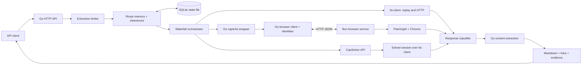
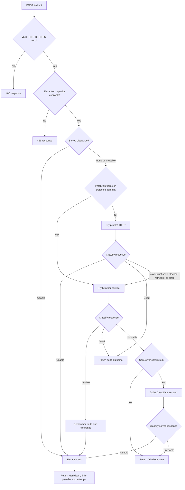
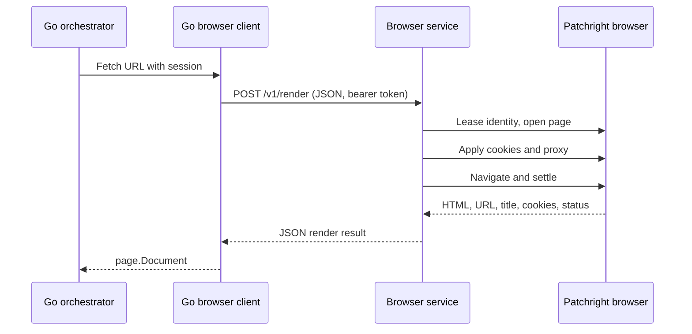
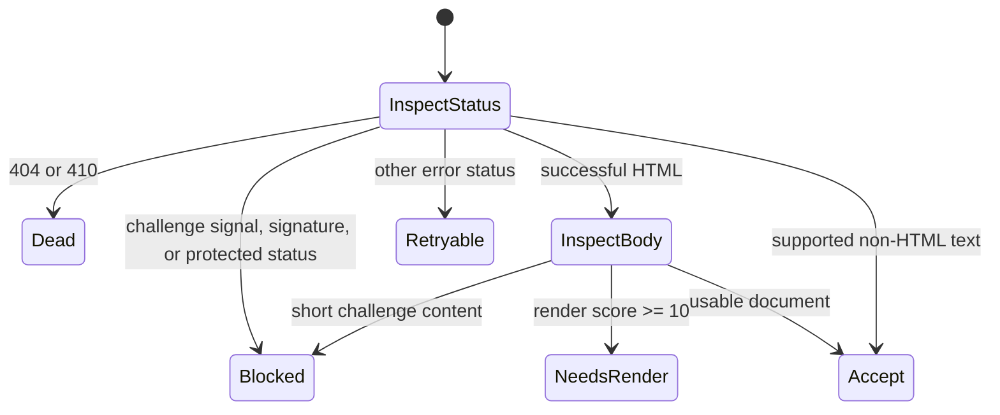
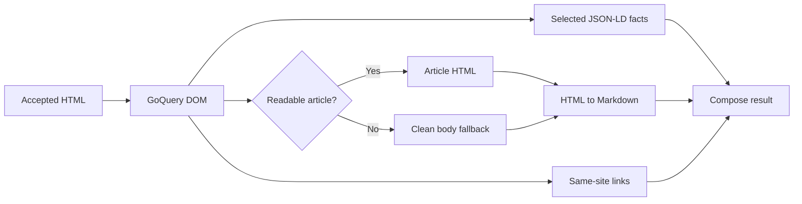
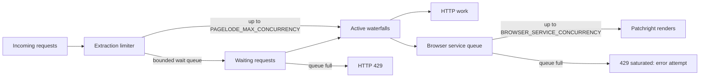
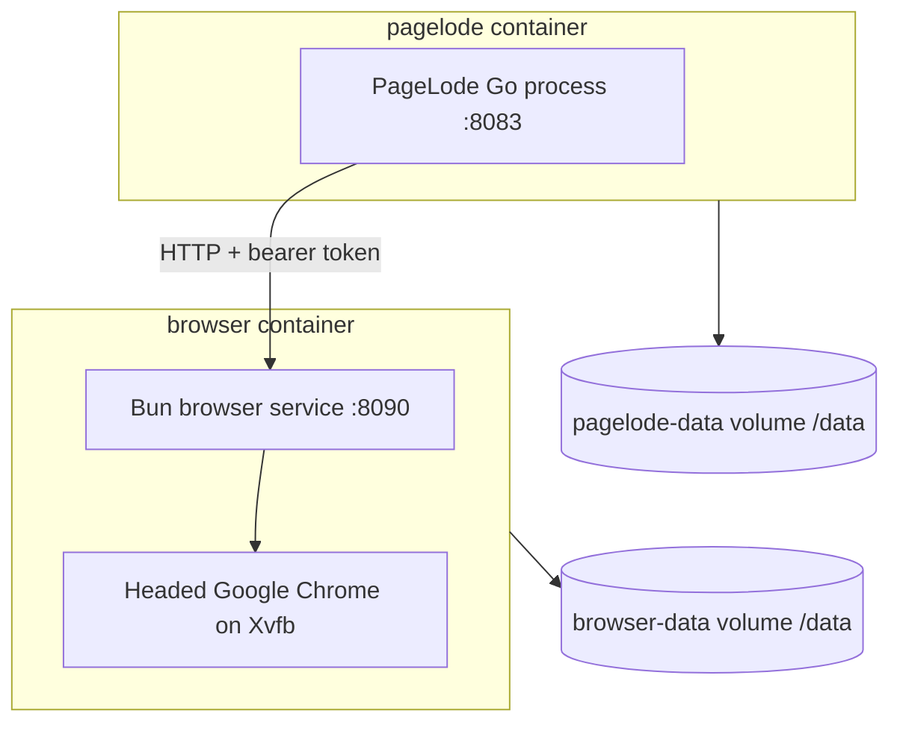
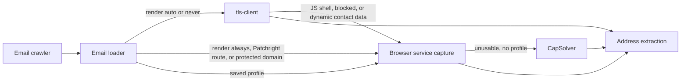

# PageLode architecture

This document describes PageLode's internal design, request lifecycle, browser boundary, escalation policy, and operational limits.

## Design goals

PageLode is designed around five constraints:

- Keep orchestration and extraction in Go.
- Use the cheapest loader capable of returning real content.
- Run every browser in one place: the Bun browser service.
- Never accept a challenge page or empty application shell as successful content.
- Bound request size, execution time, queue depth, browser concurrency, and output size.

## System overview

The Go process owns every product decision, including proxy sessions and identity rotation. The browser service can render a URL and return browser facts (HTML, cookies, headers, a remaining challenge), but it cannot choose targets, select routes, extract content, or decide whether a result is acceptable. The same application graph serves one-shot CLI requests and the long-running HTTP API.

## Request lifecycle

Every loader produces the same internal `page.Document` shape. That keeps classification and extraction independent from transport details. [Browser routing](browser-routing.md) gives the exact rules.

## The loaders

### Profiled HTTP and clearance replay

The first attempt uses `bogdanfinn/tls-client` with a current Chrome TLS profile and browser-like request headers. It is the preferred path because it avoids using a browser. When a browser render has stored a clearance for the host, the same client first replays it (provider `replay`).

The loader returns the status code, final URL, response headers, detected content type, response body, effective user agent, and portable cookies for possible browser escalation. Responses are capped at 12 MiB. It uses the current browser identity's proxy, so HTTP and the browser share one exit IP.

### Patchright

Patchright handles JavaScript shells, challenge pages, protected domains, and every other HTTP failure. It runs in a separate Bun + Hono browser service (`browser-service/`) because Patchright's maintained API is in the JavaScript ecosystem. Results keep the provider name `patchright`.

For an ordinary render, Go sends an identity key and a concrete proxy URL. The service leases that warm browser identity: a persistent Chrome context bound to that proxy, launched with the timezone and languages of the proxy's exit IP. It opens a fresh page, applies the cookies, and renders the page. Only when the page shows a challenge hint (a 401, 403, 429, or 503 status, an `x-datadome` or `cf-mitigated: challenge` header, a `__cf_chl_` URL, or a challenge title) does it try to settle a challenge. It then waits until the page goes quiet, at most `settle_ms`, and returns HTML, updated cookies, response headers, and any challenge that remains. A render with a named profile launches that profile's own persistent context instead. See [browser service](browser-service.md#waiting-for-the-page).

When `CAPSOLVER_API_KEY` is set, `captcha` wraps every browser render. When the service reports a Google `/sorry` reCAPTCHA or DataDome `challenge`, it is solved in Go through the identity's proxy and rendered again with the solved cookie; see [captchas](browser-service.md#captchas).

### CapSolver

CapSolver is an optional final escalation for Cloudflare challenges that remain after Patchright. The Go client fetches the live challenge over tls-client through a sticky proxy, creates an `AntiCloudflareTask`, polls within the extraction deadline, converts the returned clearance cookies and user agent into a portable session, and fetches the target over tls-client through the same proxy.

It is disabled unless both `CAPSOLVER_API_KEY` and an authenticated solver proxy are available. API keys and proxy credentials are never included in attempt logs. The same key also enables the Google and DataDome solving above, which needs no separate solver proxy.

## Browser service boundary

`browser` is the Go client. It calls these routes:

| Go method | Route | Use |
|---|---|---|
| `Fetch` | `POST /v1/render` | Render a page for extraction |
| `Capture` | `POST /v1/render` with `capture` and optional `profile` | Render and record network traffic for discovery and email finding |
| `CreateSession` | `POST /v1/sessions` | Open a browser session with a CDP URL (`profile login`) |
| `CloseSession` | `DELETE /v1/sessions/{id}` | Close a session and save its profile |

- Requests carry `PAGELODE_BROWSER_TOKEN` as a bearer token. Anonymous renders carry an `identity` key and a concrete `proxy_url` derived from `PAGELODE_PROXY_URL`; see [identities and rotation](browser-service.md#identities-and-rotation).
- Every render sends `settle_ms` from `PAGELODE_BROWSER_SETTLE_MS` and capture limits from `page.MaxCapture*` (200 requests, 256 KiB per body, 2 MiB total).
- The render timeout comes from the request deadline, capped at 45 seconds.
- Errors use `{"error":{"code","message"}}`. A `429 saturated` response becomes `limit.ErrSaturated` in Go.
- Responses larger than 32 MiB are rejected.

The boundary deliberately exposes browser facts rather than extraction policy. Block signatures and challenge markers live in one file, `signatures/signatures.json`, read by both Go and the service. The full API, sessions, identities, and container are documented in [browser service](browser-service.md).

## Classification

Classification occurs after every attempt and returns one of five states:

| State | Meaning | Typical next action |
|---|---|---|
| `accept` | The response contains usable content | Extract it |
| `needs_render` | The response resembles a JavaScript shell | Try the browser service |
| `blocked` | The response contains strong challenge evidence | Try the browser service |
| `retryable` | The response failed without proving it is permanently absent | Escalate |
| `dead` | The target returned 404 or 410 | Stop |

Block detection combines a challenge signal (a `challenge` fact from the service, a `cf-mitigated: challenge` header, or a `__cf_chl_` URL), HTTP status, and structural signatures for Cloudflare, Akamai, PerimeterX, DataDome, Imperva, Google, Sucuri, CAPTCHA pages, and short access-denial responses.

JavaScript-render detection uses weighted evidence rather than a single text check. Signals include hydration markers, empty application roots, script-heavy documents with little visible text, inline DOM mutation, missing semantic content, and explicit JavaScript requirements. A score of 10 or more triggers rendering.

## Content extraction

Accepted HTML remains in Go for deterministic processing:

1. Parse the document with GoQuery.
2. Attempt article extraction with Readeck's Go Readability implementation.
3. If the readable article is too small, clean the body and convert it to Markdown.
4. Add selected JSON-LD and page-description facts.
5. Collect, normalize, deduplicate, and sort up to 100 same-site links.
6. Limit returned Markdown to 12,000 Unicode characters.

## Route memory

When the browser service succeeds, PageLode remembers `patchright` for the hostname and stores the browser session as a clearance for replay. A later request to the same host can replay the clearance or begin at the browser instead of repeating an HTTP attempt that is likely to fail.

Entries expire after `PAGELODE_ROUTE_TTL`. Routes, clearances, and identity generations are written through to a local SQLite file (`internal/state`, `PAGELODE_STATE_PATH`) and loaded at start, so they survive restarts and separate CLI runs. Configured protected domains are pre-seeded to Patchright, and subdomains inherit their parent-domain rule.

## Concurrency and backpressure

The extraction limiter bounds complete request lifetimes, with up to `PAGELODE_MAX_WAITING` waiting requests, and the API rejects overload instead of allowing unbounded memory growth. Go sends at most `PAGELODE_BROWSER_NODE_SLOTS` renders to each browser service node at once; the service also queues itself (`BROWSER_SERVICE_CONCURRENCY`, `BROWSER_SERVICE_MAX_WAITING`). A `429 saturated` reply counts as an `error` attempt. An unreachable node is skipped for 15 seconds and the render retried once on the next node; with no reachable node the render fails with `limit.ErrUnavailable`.

Request contexts carry deadlines through the API, orchestrator, loaders, and browser service request.

## Package map

| Path | Responsibility |
|---|---|
| `cmd/pagelode` | CLI parsing, process wiring, HTTP lifecycle, graceful shutdown |
| `internal/api` | HTTP contract, validation, timeouts, health reporting |
| `orchestrator` | Waterfall, attempt evidence, escalation, final results |
| `emails` | Email-finding crawl, page loading policy, address extraction |
| `httpfetch` | Profiled direct HTTP loader and session capture |
| `browser` | HTTP client for the browser service: render, capture, sessions, and identity keys and rotation (`identity.go`) |
| `proxy` | Proxy URL templates and session substitution |
| `capsolver` | CapSolver task polling: Cloudflare solved-session handoff over tls-client, reCAPTCHA tokens, DataDome cookies |
| `captcha` | Solves Google `/sorry` and DataDome challenges reported by the browser service, then renders again |
| `classify` | Block, render, retry, dead, and accept decisions |
| `signatures` | Embedded `signatures/signatures.json`: block patterns and challenge signals shared with the browser service |
| `extract` | Readability, DOM cleanup, Markdown, links, structured data |
| `memory` | Expiring hostname-to-provider routes and clearances |
| `internal/state` | SQLite persistence for routes, clearances, and identity generations |
| `limit` | Bounded concurrency and queueing for extraction; `ErrSaturated` |
| `page` | Loader-neutral document and session values, capture limits |
| `browser/browsertest` | Starts the real browser service with `bun` for gated integration tests |
| `sitemap` | Site mapping crawl and URL collection from sitemaps and links |
| `discovery` | Data-endpoint discovery from one browser capture, HAR analysis, endpoint grouping |
| `scriptscan` | Script URL and relative endpoint extraction |
| `similarity` | Simhash fingerprints and near-duplicate page index |
| `urlshape` | URL shapes, sampling, and path templates |
| `profile` | Named browser profile name validation |
| `internal/emailstore` | SQLite persistence for bulk email jobs |
| `queue` | Shared Postgres URL queue: import, leased claims, completion, retry, counts |
| `batch` | Two-stage bulk runner over `queue`, per-host limits, rolling JSONL.gz output; see [batch scraping](batch.md) |
| `browser-service/src` | Bun + Hono browser service: Patchright renders, identities, sessions, profiles, request validation |

## Failure behaviour

Each attempt records its provider, duration, status, classification, render score, and a concise detail. Transport errors are evidence too. PageLode returns a structured `failed` or `dead` result when the waterfall completes without usable content; malformed API requests and capacity failures use HTTP error statuses.

This separation makes an extraction failure observable without pretending that block-page HTML is valid content.

## Deployment model

The provided `compose.yaml` runs two containers:

| Service | Image | Contents |
|---|---|---|
| `pagelode` | root `Dockerfile` | Static Go binary and `signatures/`; no browser, Node, or Bun. `PAGELODE_STATE_PATH=/data/state.sqlite` on the `pagelode-data` volume. Listens on `8083` |
| `browser` | `browser-service/Dockerfile` | `oven/bun` with Google Chrome running headed on an Xvfb display, plus fluxbox, PulseAudio, Mesa, and fonts. Listens on `127.0.0.1:8090` |

PageLode reaches the browser service at `http://browser:8090`. Both containers share `BROWSER_SERVICE_TOKEN`. Browser identities and profiles persist in the `browser-data` volume at `/data`, and `BROWSER_TZ` sets the browser container's `TZ`. PageLode's routes, clearances, and identity generations persist in the `pagelode-data` volume. The browser image builds from the repository root (`docker build -f browser-service/Dockerfile .`) so it can copy `signatures/`. The PageLode image defaults to `pagelode serve`; supplying a URL instead runs a one-shot extraction.

Orchestration stays in Go; the browser service only renders, and the headed Chrome desktop lives in its own image.

## Endpoint discovery

`POST /discover` runs one browser-service capture and returns an endpoint breakdown. Capture starts before navigation and uses the existing proxies and classifier; it does not escalate or learn routes. The API and CLI also accept offline HAR captures. See [discovery.md](discovery.md) for the contract, module map, and limits.

## Email finding

`pagelode emails` and `POST /emails` are a separate pathway from `/extract`. The email service crawls a site within page, address, and duration limits, prioritizing contact, team, and about pages plus sitemap entries. Each page goes through its own loader instead of the extraction orchestrator:

The loader shares the same HTTP client, browser service client, CapSolver client, route memory, and proxy settings as extraction, so the Cloudflare and proxy behavior in [configuration](configuration.md#passing-cloudflare-challenges) applies here too. Hosts already known to need Patchright, and protected domains, skip HTTP. `render: never` stops after HTTP. A saturated browser service stops the page load. The loader reads full HTML and captured JSON responses rather than the Markdown output, because contact details often sit in headers, footers, and API responses. See [emails.md](emails.md) for the contract and limits.

## Current limitations

- PDF extraction is not implemented.
- Route memory and clearances persist in a local SQLite file and are not shared between replicas.
- Browser processes are reused through the browser service's warm identity pool. Interactive browser sessions exist only as raw CDP sessions on the browser service.
- Challenge interaction is intentionally small and cannot solve every protection system.
- Proxy credentials are supported. The browser service matches timezone and languages to the proxy exit IP, but proxy quality and browser fingerprint coherence remain deployment concerns.
- There is no authentication layer in front of the PageLode HTTP API yet. The browser service accepts a bearer token.

The planned path from the existing OpenExtract service is documented in [migration.md](migration.md).
