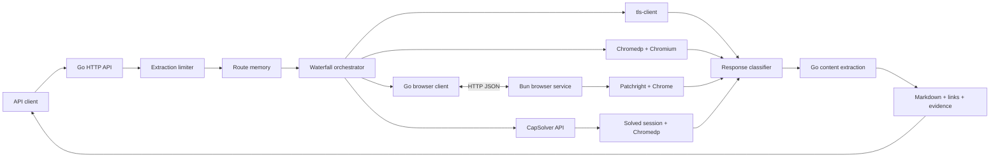
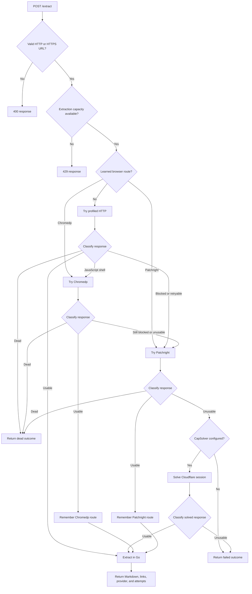
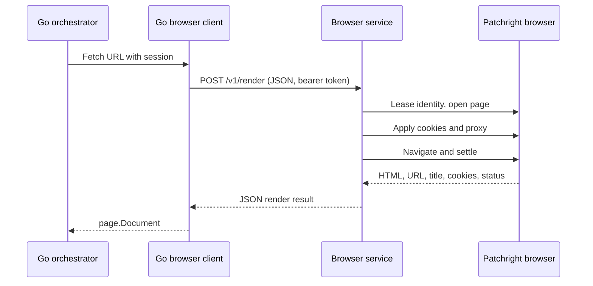
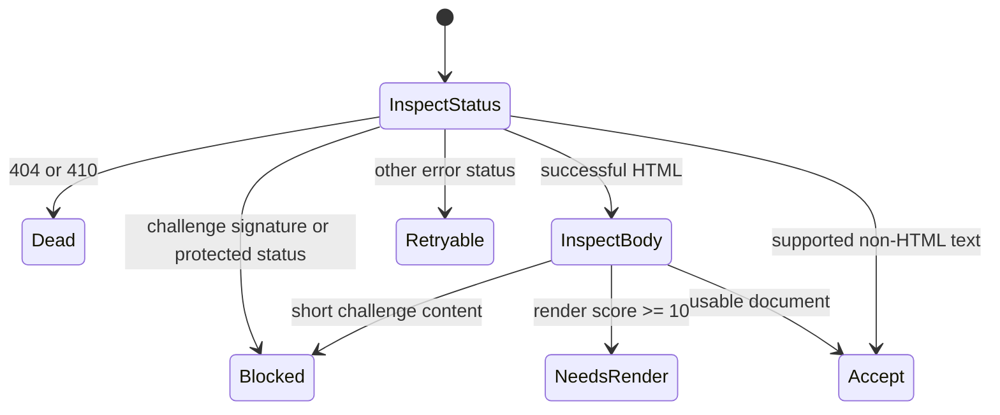
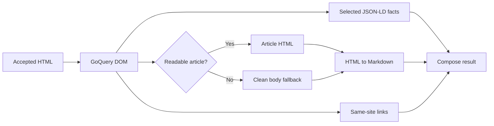
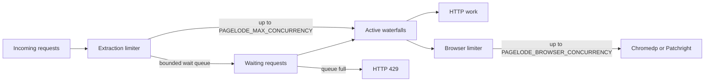
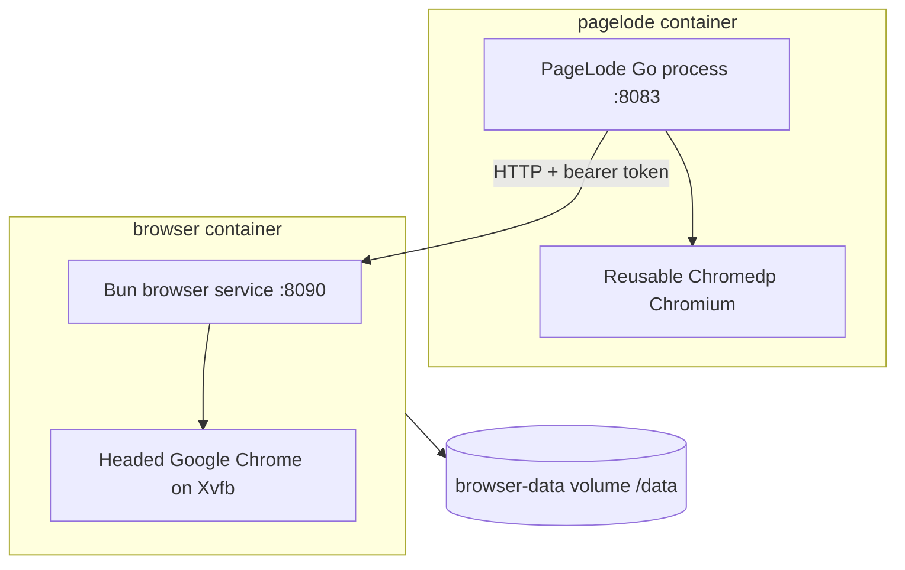
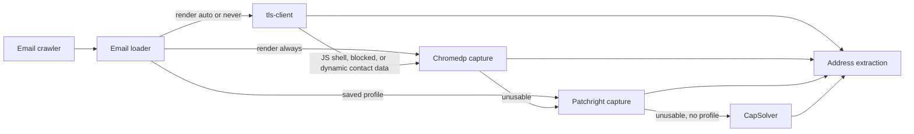

# PageLode architecture

This document describes PageLode's internal design, request lifecycle, browser boundary, escalation policy, and operational limits.

## Design goals

PageLode is designed around five constraints:

- Keep orchestration and extraction in Go.
- Use the cheapest loader capable of returning real content.
- Treat JavaScript rendering and anti-bot challenges as different problems.
- Never accept a challenge page or empty application shell as successful content.
- Bound request size, execution time, queue depth, browser concurrency, and output size.

## System overview

The Go process owns every product decision. The browser service can render a URL and return browser state, but it cannot choose targets, select routes, extract content, or decide whether a result is acceptable. The same application graph serves one-shot CLI requests and the long-running HTTP API.

## Request lifecycle

Every loader produces the same internal `page.Document` shape. That keeps classification and extraction independent from transport details.

## The four loaders

### Profiled HTTP

The first attempt uses `bogdanfinn/tls-client` with a current Chrome TLS profile and browser-like request headers. It is the preferred path because it avoids starting or using a browser.

The loader returns the status code, final URL, detected content type, response body, effective user agent, and portable cookies for possible browser escalation. Responses are capped at 12 MiB.

### Chromedp

Chromedp handles ordinary JavaScript rendering. PageLode lazily launches one reusable Chromium process and creates a fresh tab for each request. Cookies and the user agent from the HTTP attempt are carried into the tab when available.

Chromedp is used for application shells and pages whose useful content is created after JavaScript runs. It is not treated as the stealth path.

### Patchright

Patchright handles confirmed challenge pages, protected domains, and failures that warrant the most expensive local loader. It runs in a separate Bun + Hono browser service (`browser-service/`) because Patchright's maintained API is in the JavaScript ecosystem. Results keep the provider name `patchright`.

For an ordinary render, the service leases a warm browser identity: a persistent Chrome context keyed by identity or proxy, launched with the timezone and languages of the proxy's exit IP. It opens a fresh page, applies the cookies, renders the page, makes a bounded attempt to settle visible challenges, and returns HTML plus updated cookies. A render with a named profile launches that profile's own persistent context instead. See [browser service](browser-service.md).

### CapSolver

CapSolver is an optional final escalation for Cloudflare challenges that remain after local Patchright. The Go client fetches the live challenge through a sticky proxy, creates an `AntiCloudflareTask`, polls within the extraction deadline, converts the returned clearance cookies and user agent into a portable session, and renders the target with Chromedp through the same proxy.

It is disabled unless both `CAPSOLVER_API_KEY` and an authenticated solver proxy are available. API keys and proxy credentials are never included in attempt logs.

## Browser service boundary

`internal/browser` is the Go client. It calls these routes:

| Go method | Route | Use |
|---|---|---|
| `Fetch` | `POST /v1/render` | Render a page for extraction |
| `Capture` | `POST /v1/render` with `capture` and optional `profile` | Render and record network traffic for discovery and email finding |
| `CreateSession` | `POST /v1/sessions` | Open a browser session with a CDP URL (`profile login`) |
| `CloseSession` | `DELETE /v1/sessions/{id}` | Close a session and save its profile |

- Requests carry `PAGELODE_BROWSER_TOKEN` as a bearer token and `PAGELODE_PROXY_URL` as `proxy_url` when they are set.
- The render timeout comes from the request deadline, capped at 45 seconds.
- Errors use `{"error":{"code","message"}}`. A `429 saturated` response counts as browser limiter saturation in Go.
- Responses larger than 32 MiB are rejected.

The boundary deliberately exposes browser facts rather than extraction policy. The full API, sessions, identities, and container are documented in [browser service](browser-service.md).

## Classification

Classification occurs after every attempt and returns one of five states:

| State | Meaning | Typical next action |
|---|---|---|
| `accept` | The response contains usable content | Extract it |
| `needs_render` | The response resembles a JavaScript shell | Try Chromedp |
| `blocked` | The response contains strong challenge evidence | Try Patchright |
| `retryable` | The response failed without proving it is permanently absent | Escalate |
| `dead` | The target returned 404 or 410 | Stop |

Block detection combines HTTP status with structural signatures for Cloudflare, Akamai, PerimeterX, DataDome, Imperva, Sucuri, CAPTCHA pages, and short access-denial responses.

JavaScript-render detection uses weighted evidence rather than a single text check. Signals include hydration markers, empty application roots, script-heavy documents with little visible text, inline DOM mutation, missing semantic content, and explicit JavaScript requirements. A score of 10 or more triggers rendering.

## Content extraction

Accepted HTML remains in Go for deterministic processing:

1. Parse the document with GoQuery.
2. Attempt article extraction with Readeck's Go Readability implementation.
3. If the readable article is too small, clean the body and convert it to Markdown.
4. Add selected JSON-LD and page-description facts.
5. Collect, normalize, deduplicate, and sort up to 100 same-site links.
6. Limit returned Markdown to 12,000 Unicode characters.

## Route memory

When Chromedp or Patchright succeeds, PageLode remembers that provider for the hostname. A later request to the same host can begin at the known working browser layer instead of repeating cheaper attempts that are likely to fail.

Entries expire after `PAGELODE_ROUTE_TTL`. The store is process-local by design; there is no external database in the current architecture. Configured protected domains are pre-seeded to Patchright, and subdomains inherit their parent-domain rule.

## Concurrency and backpressure

The extraction limiter bounds complete request lifetimes. A second limiter independently protects browser capacity. Both share the configured maximum waiting depth, and the API rejects overload instead of allowing unbounded memory growth. The browser service applies its own limit (`BROWSER_SERVICE_CONCURRENCY`, `BROWSER_SERVICE_MAX_WAITING`).

Request contexts carry deadlines through the API, orchestrator, loaders, browser queue, and browser service request.

## Package map

| Path | Responsibility |
|---|---|
| `cmd/pagelode` | CLI parsing, process wiring, HTTP lifecycle, graceful shutdown |
| `internal/api` | HTTP contract, validation, timeouts, health reporting |
| `internal/orchestrator` | Waterfall, attempt evidence, escalation, final results |
| `internal/emails` | Email-finding crawl, page loading policy, address extraction |
| `internal/httpfetch` | Profiled direct HTTP loader and session capture |
| `internal/chromefetch` | Ordinary JavaScript rendering with Chromedp |
| `internal/browser` | HTTP client for the browser service: render, capture, and sessions |
| `internal/capsolver` | Managed Cloudflare task polling and solved-session handoff |
| `internal/classify` | Block, render, retry, dead, and accept decisions |
| `internal/extract` | Readability, DOM cleanup, Markdown, links, structured data |
| `internal/memory` | Expiring hostname-to-provider routes |
| `internal/limit` | Bounded concurrency and queueing |
| `internal/page` | Loader-neutral document and session values |
| `internal/browser/browsertest` | Starts the real browser service with `bun` for gated integration tests |
| `browser-service/src` | Bun + Hono browser service: Patchright renders, identities, sessions, profiles, request validation |

## Failure behaviour

Each attempt records its provider, duration, status, classification, render score, and a concise detail. Transport errors are evidence too. PageLode returns a structured `failed` or `dead` result when the waterfall completes without usable content; malformed API requests and capacity failures use HTTP error statuses.

This separation makes an extraction failure observable without pretending that block-page HTML is valid content.

## Deployment model

The provided `compose.yaml` runs two containers:

| Service | Image | Contents |
|---|---|---|
| `pagelode` | root `Dockerfile` | Static Go binary and Debian Chromium for Chromedp; no Node or Bun. Listens on `8083` |
| `browser` | `browser-service/Dockerfile` | `oven/bun` with Google Chrome running headed on an Xvfb display, plus fluxbox, PulseAudio, Mesa, and fonts. Listens on `127.0.0.1:8090` |

PageLode reaches the browser service at `http://browser:8090`. Both containers share `BROWSER_SERVICE_TOKEN`. Browser identities and profiles persist in the `browser-data` volume at `/data`, and `BROWSER_TZ` sets the browser container's `TZ`. The PageLode image defaults to `pagelode serve`; supplying a URL instead runs a one-shot extraction.

Orchestration stays in Go; the browser service only renders, and the headed Chrome desktop lives in its own image.

## Endpoint discovery

`POST /discover` runs browser capture and returns an endpoint breakdown. Capture starts before navigation and uses the existing browser limiter, proxies, protected-domain rules, and classifier. Go analyzes both chromedp and Patchright observations. The API and CLI also accept offline HAR captures. See [discovery.md](discovery.md) for the contract, module map, and limits.

## Email finding

`pagelode emails` and `POST /emails` are a separate pathway from `/extract`. The email service crawls a site within page, address, and duration limits, prioritizing contact, team, and about pages plus sitemap entries. Each page goes through its own loader instead of the extraction orchestrator:

The loader shares the same HTTP client, browsers, CapSolver client, route memory, browser limiter, and proxy settings as extraction, so the Cloudflare and proxy behavior in [configuration](configuration.md#passing-cloudflare-challenges) applies here too. Hosts already known to need Patchright skip HTTP and Chromedp. `render: never` stops after HTTP. The loader reads full HTML and captured JSON responses rather than the Markdown output, because contact details often sit in headers, footers, and API responses. See [emails.md](emails.md) for the contract and limits.

## Current limitations

- PDF extraction is not implemented.
- Route memory is not shared between replicas.
- Browser processes are reused through the browser service's warm identity pool. Interactive browser sessions exist only as raw CDP sessions on the browser service.
- Challenge interaction is intentionally small and cannot solve every protection system.
- Proxy credentials are supported. The browser service matches timezone and languages to the proxy exit IP, but proxy quality and browser fingerprint coherence remain deployment concerns.
- There is no authentication layer in front of the PageLode HTTP API yet. The browser service accepts a bearer token.

The planned path from the existing OpenExtract service is documented in [migration.md](migration.md).
