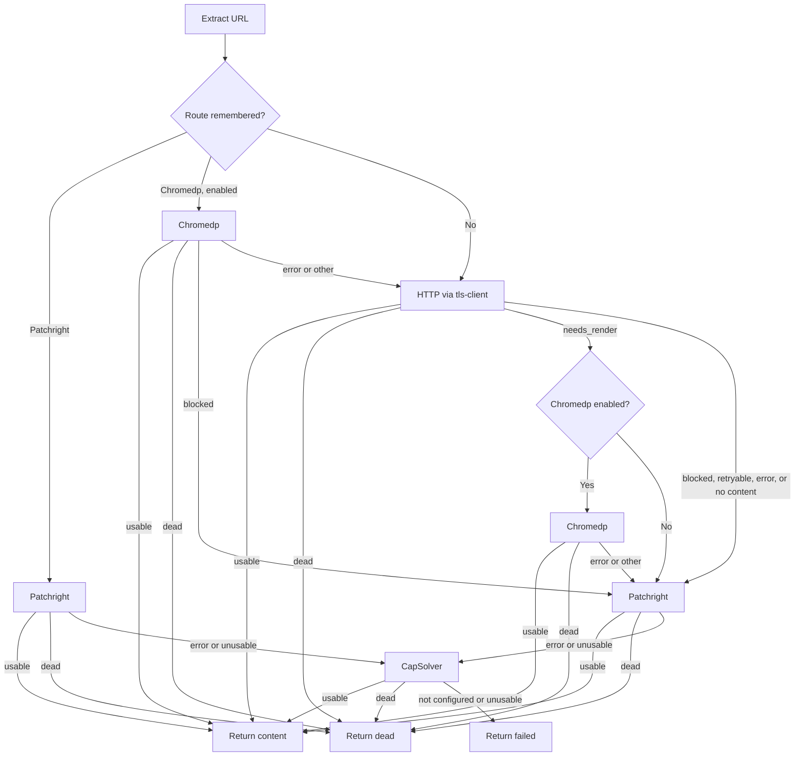
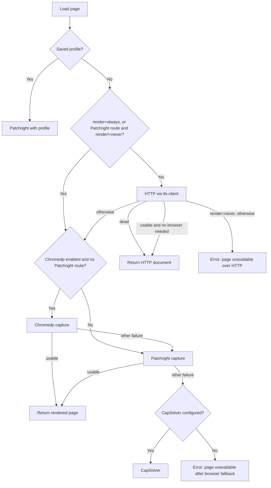

# Browser routing

This document describes exactly how PageLode decides whether a page needs a browser, and which one. [architecture.md](architecture.md) gives the overview; this page is the rule-by-rule breakdown.

Two pathways make the decision:

| Pathway | Entry point | Decision code |
|---|---|---|
| `/extract` and `pagelode <url>` | `orchestrator.Service.Extract` | `internal/orchestrator/orchestrator.go` |
| `/emails` and `pagelode emails` | `emails.Loader.Load` | `internal/emails/loader.go` |

Both use the same classifier (`internal/classify`) and route memory (`internal/memory`).

## Loaders

| Provider | Library | Cost | Role |
|---|---|---|---|
| `replay` | `bogdanfinn/tls-client` with a browser-harvested session: same proxy IP, cookies, and Chrome headers | Cheapest | Tried first when a browser render has recorded a clearance for the host; see [clearance replay](browser-service.md#clearance-replay) |
| `tls` | `bogdanfinn/tls-client` with a Chrome TLS profile | Cheapest | Always tried first unless a route is remembered |
| `chromedp` | `chromedp/chromedp` driving one reusable Chromium | Medium | JavaScript shells; skipped when `PAGELODE_CHROMEDP_ENABLED=false` |
| `patchright` | Patchright in the browser service (`browser-service/`), called over HTTP by `internal/browser`; `internal/captcha` solves Google `/sorry` and DataDome sliders in the result when `CAPSOLVER_API_KEY` is set | High | Challenge pages, protected domains, and every other failure |
| `capsolver` | CapSolver API, then Chromedp with the solved session | Highest | Optional last resort; needs `CAPSOLVER_API_KEY` and a sticky authenticated proxy |

The cookies and user agent from the HTTP attempt are passed to each browser fallback.

## Classification

`classify.Document` runs after every attempt. The checks run in this order, and the first match wins.

| Order | Condition | Result |
|---|---|---|
| 1 | Status 404 or 410 | `dead` |
| 2 | Non-HTML response with status ≥ 500 | `retryable` |
| 3 | Non-HTML response otherwise | `accept` |
| 4 | A high-confidence block signature in the first 500,000 bytes | `blocked` |
| 5 | Status 401, 403, 429, 503, or 520–530 | `blocked` |
| 6 | Any other status ≥ 400 | `retryable` |
| 7 | Empty HTML | `needs_render` (score 10) |
| 8 | HTML that cannot be parsed | `retryable` |
| 9 | No `<body>` | `needs_render` (score 10) |
| 10 | Under 2,500 visible characters and a short block pattern in the first 30,000 bytes | `blocked` |
| 11 | Render score ≥ 10 | `needs_render` |
| 12 | Everything else | `accept` |

Visible text is the `<body>` text with `script`, `style`, `noscript`, `svg`, and `template` removed and whitespace collapsed. It is measured in Unicode characters.

### High-confidence block signatures

| Label | Match |
|---|---|
| Cloudflare challenge form | `challenge-form` followed by `__cf_chl_f_tk=`, or `/cdn-cgi/challenge-platform/…orchestrate` |
| Cloudflare firewall response | `` containing four digits |
| Akamai reference block | `Reference #<n>.<hex>.<n>.<hex>` |
| PerimeterX challenge | `window._pxAppId =` or `captcha.px-cdn.net` |
| DataDome challenge | `captcha-delivery.com` |
| Imperva challenge | `_Incapsula_Resource` or `Incapsula incident ID` |
| Sucuri firewall | `Sucuri WebSite Firewall` |

### Short block patterns

These patterns are checked only when the page has under 2,500 visible characters, so that ordinary pages mentioning these words are not treated as blocked.

| Label | Match |
|---|---|
| Cloudflare interstitial | `<title>Just a moment`, or `checking your browser` |
| Human verification | `please verify you are human`, or `verifying that you are human` |
| Access denial | `access denied`, `pardon our interruption`, or `request unsuccessful` |
| CAPTCHA challenge | `class="g-recaptcha"`, `class="h-captcha"`, or `complete the captcha` |

All patterns are case-insensitive.

### Render score

The signals add together. A total of 10 or more classifies the page as `needs_render`. Every attempt records its score as `renderScore` in the attempt evidence.

| Points | Signal | Visible text condition |
|---:|---|---|
| 10 | `<noscript>` text says JavaScript is required (`enable javascript`, `javascript is required`, `requires javascript`, `javascript to run`) | Any |
| 10 | `#__NEXT_DATA__`, `#__NUXT_DATA__`, `[data-reactroot]`, or `[data-react-root]` is present | Under 1,000 |
| 10 | `#app`, `#root`, `#__next`, or `#__nuxt` has no visible text | Under 500 |
| 6 | 4 or more `script[src]` elements | Under 500 |
| 5 | An inline script calls `appendChild`, `replaceChildren`, `insertAdjacentHTML`, `createElement`, or `document.write` | Under 500 |
| 5 | No `p`, `h1`–`h6`, `article`, `section`, `li`, `td`, or `pre` elements, and at least one `script[src]` | Any |
| 5 | Minimal visible text | Under 50 |

A single strong signal (10 points) is enough to trigger rendering. Weak signals must combine: for example, 4 or more external scripts (6) plus inline DOM mutation (5) reaches 11.

## Extraction waterfall

1. **Remembered route.** When a remembered route exists, its browser runs first.
   - Patchright: content is returned if usable, `dead` stops the waterfall, and anything else goes to CapSolver. The HTTP step never runs.
   - Chromedp: content is returned if usable, and `dead` stops the waterfall. A `blocked` result escalates to Patchright. A transport error or any other result falls back to the normal waterfall from step 2. A Chromedp route is ignored while Chromedp is disabled.
2. **HTTP.** `tls-client` loads the page and the classifier sorts the result.
3. **Usable content.** The result is `accept` and content extraction produced something. For text, the body must not be blank. For HTML, `extract.HTML` must return non-blank Markdown. Any other content type, PDF included, is not usable.
4. **Routing from the HTTP result.**
   - `dead` stops the waterfall.
   - `needs_render` tries Chromedp when it is enabled, otherwise Patchright.
   - `blocked` and `retryable` go straight to Patchright.
   - A transport error goes straight to Patchright.
   - An `accept` result whose content extraction comes back empty also goes to Patchright.
5. **Chromedp.** Content is returned if usable, and `dead` stops the waterfall. Anything else escalates to Patchright with the HTTP session.
6. **Patchright.** Content is returned if usable, and `dead` stops the waterfall. Anything else escalates to CapSolver.
7. **CapSolver.** If it is not configured, or was already tried, the result is `failed`. Otherwise its result is returned if usable, `dead` if dead, and `failed` in every other case.

### Rules

- **Each provider runs at most once per request**, with one exception: if a remembered Chromedp route falls back to the HTTP step and HTTP returns `needs_render`, Chromedp runs a second time. The once-only check guards only Patchright and CapSolver.
- **Browser limiter.** Chromedp and Patchright attempts run behind the browser limiter (`PAGELODE_BROWSER_CONCURRENCY`, with a queue of up to `PAGELODE_MAX_WAITING`). A saturated queue or a cancelled context counts as an `error` attempt, and the waterfall moves on to the next step.
- **Route learning.** A usable Chromedp or Patchright result records that provider for the hostname, valid for `PAGELODE_ROUTE_TTL`. HTTP successes are not recorded, and CapSolver successes are not recorded by the orchestrator.
- **Evidence.** Every attempt is recorded with its provider, outcome, status, duration, classification, reason, and render score.

## Route memory

`memory.Routes.Preferred` resolves a hostname as follows:

1. Lowercase the hostname and remove any trailing dot.
2. If the host matches a `PAGELODE_PROTECTED_DOMAINS` entry exactly, or is a subdomain of one, use Patchright. Protected domains never expire.
3. Otherwise use the learned entry if it has not expired. Expired entries are deleted when read.

The store lives in process memory and is lost on restart.

## Email loader

The email crawler loads each page through `emails.Loader`, not the orchestrator. Its `render` option and page priority change the rules.

### Usable

`usable` requires a status below 400 and a classification other than `blocked`, `retryable`, or `dead`. Unlike the orchestrator, it accepts `needs_render` documents and does not require non-empty extracted content.

### Needs a browser

In `auto` mode, `needsBrowser` decides whether a usable HTTP page still needs rendering. It runs these checks in order:

1. A non-HTML document, or HTML that already contains at least one email address: no browser.
2. The classifier returned `needs_render`: browser.
3. An inline script contains `fetch(`, `xmlhttprequest`, or `axios`: browser.
4. The URL is a priority page and the page has at least one `script[src]`: browser. Priority pages are URLs containing `contact`, `team`, `staff`, `directory`, `people`, `about`, `location`, or `support`.
5. Otherwise: no browser.

### Other differences from the orchestrator

- An HTTP result classified `blocked` switches the rest of the load to Patchright, skipping Chromedp.
- A remembered Chromedp route does not skip the HTTP step; only a Patchright route does.
- If the context is cancelled or the browser limiter is saturated, the load stops and returns that error instead of escalating to the next browser.
- Browser captures wait 500 ms after loading so that network traffic can be observed.
- Every usable browser capture without a profile records its provider in route memory.
- Profile loads always use Patchright and never record routes.
