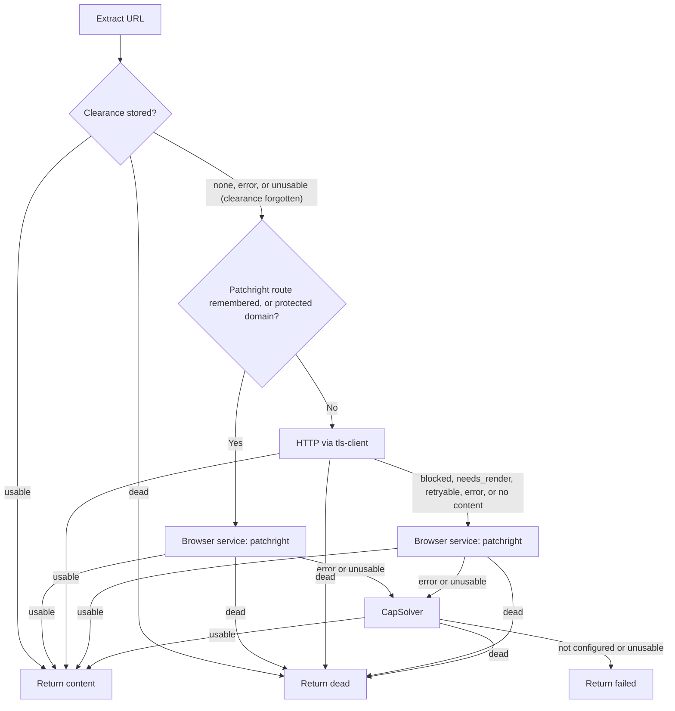
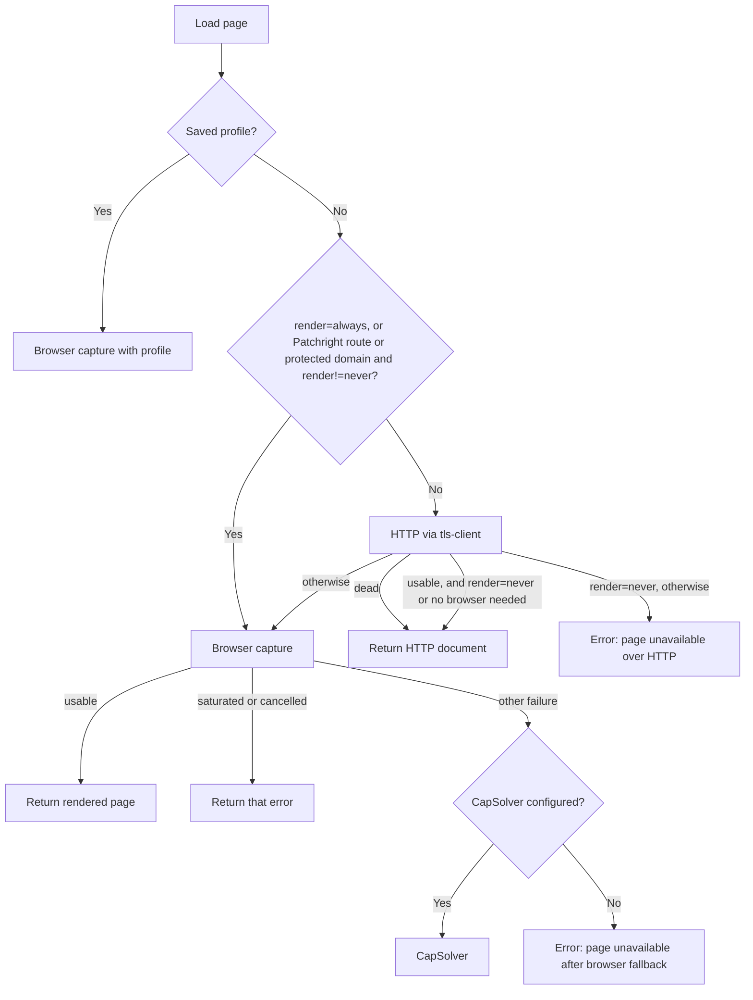

# Browser routing

This document describes exactly how PageLode decides whether a page needs a browser. Every browser runs in the single Bun browser service (`browser-service/`). [architecture.md](architecture.md) gives the overview; this page is the rule-by-rule breakdown.

Three pathways make the decision:

| Pathway | Entry point | Decision code |
|---|---|---|
| `/extract` and `pagelode <url>` | `orchestrator.Service.Extract` | `internal/orchestrator/orchestrator.go` |
| `/emails` and `pagelode emails` | `emails.Loader.Load` | `internal/emails/loader.go` |
| `/discover` and `pagelode discover` | `discovery.Service` | `internal/discovery/service.go`; one browser capture, no escalation or route memory; see [discovery](discovery.md#loading-and-limits) |

Extraction and email loading use the same classifier (`internal/classify`) and route memory (`internal/memory`), persisted in SQLite (`internal/state`).

## Loaders

| Provider | Library | Cost | Role |
|---|---|---|---|
| `replay` | `bogdanfinn/tls-client` with a browser-harvested session: same proxy IP, cookies, and Chrome headers | Cheapest | Tried first when a browser render has recorded a clearance for the host; see [clearance replay](browser-service.md#clearance-replay) |
| `tls` | `bogdanfinn/tls-client` with a Chrome TLS profile | Cheapest | Tried unless a route is remembered |
| `patchright` | Patchright in the browser service, called over HTTP by `internal/browser` through the `internal/captcha` wrapper, which solves Google `/sorry` and DataDome challenges reported by the service when `CAPSOLVER_API_KEY` is set | High | JavaScript shells, challenge pages, protected domains, and every other HTTP failure |
| `capsolver` | CapSolver `AntiCloudflareTask`, then tls-client fetches the solved page through the same sticky proxy | Highest | Optional last resort; needs `CAPSOLVER_API_KEY` and a sticky authenticated proxy |

The cookies and user agent from the HTTP attempt are passed to each browser fallback. HTTP uses the current browser identity's proxy, so both share one exit IP; see [identities and rotation](browser-service.md#identities-and-rotation).

## Classification

`classify.Document` runs after every attempt. The checks run in this order, and the first match wins. Block patterns and challenge signals come from `signatures/signatures.json`, shared with the browser service.

| Order | Condition | Result |
|---|---|---|
| 1 | Status 404 or 410 | `dead` |
| 2 | A challenge signal: a `challenge` fact from the browser service, header `cf-mitigated: challenge`, or a final URL containing `__cf_chl_` | `blocked` |
| 3 | Non-HTML response with status ≥ 500 | `retryable` |
| 4 | Non-HTML response otherwise | `accept` |
| 5 | A high-confidence block signature in the first 500,000 bytes | `blocked` |
| 6 | Status 401, 403, 429, 503, or 520–530 | `blocked` |
| 7 | Any other status ≥ 400 | `retryable` |
| 8 | Empty HTML | `needs_render` (score 10) |
| 9 | HTML that cannot be parsed | `retryable` |
| 10 | No `<body>` | `needs_render` (score 10) |
| 11 | Under 2,500 visible characters and a short block pattern in the first 30,000 bytes | `blocked` |
| 12 | Render score ≥ 10 | `needs_render` |
| 13 | Everything else | `accept` |

Challenge signal reasons are "<vendor> challenge remained after browser settling", "Cloudflare challenge header", and "challenge URL __cf_chl_". HTTP documents carry response headers; browser documents carry the last main-frame document's headers.

Visible text is the `<body>` text with `script`, `style`, `noscript`, `svg`, and `template` removed and whitespace collapsed. It is measured in Unicode characters.

### High-confidence block signatures

| Label | Match |
|---|---|
| Cloudflare challenge form | `challenge-form` followed by `__cf_chl_f_tk=`, or `/cdn-cgi/challenge-platform/…orchestrate` |
| Cloudflare firewall response | `` containing four digits |
| Akamai reference block | `Reference #<n>.<hex>.<n>.<hex>` |
| PerimeterX challenge | `window._pxAppId =` or `captcha.px-cdn.net` |
| DataDome challenge | `captcha-delivery.com` |
| Imperva challenge | `_Incapsula_Resource` or `Incapsula incident ID` |
| Google JavaScript wall | `emsg=SG_REL` query parameter |
| Sucuri firewall | `Sucuri WebSite Firewall` |

### Short block patterns

These patterns are checked only when the page has under 2,500 visible characters, so that ordinary pages mentioning these words are not treated as blocked.

| Label | Match |
|---|---|
| Cloudflare interstitial | `<title>Just a moment`, or `checking your browser` |
| Human verification | `please verify you are human`, or `verifying that you are human` |
| Access denial | `access denied`, `pardon our interruption`, or `request unsuccessful` |
| CAPTCHA challenge | `class="g-recaptcha"`, `class="h-captcha"`, or `complete the captcha` |

All patterns are case-insensitive.

### Render score

The signals add together. A total of 10 or more classifies the page as `needs_render`. Every attempt records its score as `renderScore` in the attempt evidence.

| Points | Signal | Visible text condition |
|---:|---|---|
| 10 | `<noscript>` text says JavaScript is required (`enable javascript`, `javascript is required`, `requires javascript`, `javascript to run`) | Any |
| 10 | `#__NEXT_DATA__`, `#__NUXT_DATA__`, `[data-reactroot]`, or `[data-react-root]` is present | Under 1,000 |
| 10 | `#app`, `#root`, `#__next`, or `#__nuxt` has no visible text | Under 500 |
| 6 | 4 or more `script[src]` elements | Under 500 |
| 5 | An inline script calls `appendChild`, `replaceChildren`, `insertAdjacentHTML`, `createElement`, or `document.write` | Under 500 |
| 5 | No `p`, `h1`–`h6`, `article`, `section`, `li`, `td`, or `pre` elements, and at least one `script[src]` | Any |
| 5 | Minimal visible text | Under 50 |

A single strong signal (10 points) is enough to trigger rendering. Weak signals must combine: for example, 4 or more external scripts (6) plus inline DOM mutation (5) reaches 11.

## Extraction waterfall

1. **Clearance replay.** When a browser render has stored a clearance for the host, tls-client replays it (provider `replay`). Usable content is returned and `dead` stops the waterfall. Anything else forgets the clearance and continues.
2. **Remembered route.** When the host has a remembered `patchright` route or matches a protected domain, the browser service runs first. Content is returned if usable, `dead` stops the waterfall, and anything else, including a transport error, goes to CapSolver. The HTTP step never runs.
3. **HTTP.** `tls-client` loads the page and the classifier sorts the result.
4. **Usable content.** The result is `accept` and content extraction produced something. For text, the body must not be blank. For HTML, `extract.HTML` must return non-blank Markdown. Any other content type, PDF included, is not usable.
5. **Routing from the HTTP result.**
   - `dead` stops the waterfall.
   - `blocked`, `needs_render`, and `retryable` go to the browser service with the HTTP session.
   - A transport error goes to the browser service.
   - An `accept` result whose content extraction comes back empty also goes to the browser service.
6. **Browser service.** Content is returned if usable, and `dead` stops the waterfall. Anything else escalates to CapSolver.
7. **CapSolver.** If it is not configured, or was already tried, the result is `failed`. Otherwise its result is returned if usable, `dead` if dead, and `failed` in every other case.

### Rules

- **Each provider runs at most once per request.**
- **Browser limit.** Go has no browser limiter. The browser service's own queue (`BROWSER_SERVICE_CONCURRENCY`, `BROWSER_SERVICE_MAX_WAITING`) is the only browser limit. Its `429 saturated` reply becomes `limit.ErrSaturated` in Go and counts as an `error` attempt; a cancelled context does too. The waterfall then moves on to the next step.
- **Route learning.** A usable browser result records `patchright` for the hostname, valid for `PAGELODE_ROUTE_TTL`, and records the browser session as the host's clearance. HTTP, replay, and CapSolver successes are not recorded.
- **Evidence.** Every attempt is recorded with its provider, outcome, status, duration, classification, reason, and render score.

## Route memory

`memory.Routes.Preferred` resolves a hostname as follows:

1. Lowercase the hostname and remove any trailing dot.
2. If the host matches a `PAGELODE_PROTECTED_DOMAINS` entry exactly, or is a subdomain of one, use Patchright. Protected domains never expire.
3. Otherwise use the learned entry if it has not expired. Expired entries are deleted when read.

Learned routes and clearances are written through to the SQLite state file at `PAGELODE_STATE_PATH` and loaded at start with expired rows pruned, so they survive restarts and separate CLI runs. A failed write is logged and does not stop the request. See [configuration](configuration.md#state-file).

## Email loader

The email crawler loads each page through `emails.Loader`, not the orchestrator. Its `render` option and page priority change the rules.

### Usable

`usable` requires a status below 400 and a classification other than `blocked`, `retryable`, or `dead`. Unlike the orchestrator, it accepts `needs_render` documents and does not require non-empty extracted content.

### Needs a browser

In `auto` mode, `needsBrowser` decides whether a usable HTTP page still needs rendering. It runs these checks in order:

1. A non-HTML document, or HTML that already contains at least one email address: no browser.
2. The classifier returned `needs_render`: browser.
3. An inline script contains `fetch(`, `xmlhttprequest`, or `axios`: browser.
4. The URL is a priority page and the page has at least one `script[src]`: browser. Priority pages are URLs containing `contact`, `team`, `staff`, `directory`, `people`, `about`, `location`, or `support`.
5. Otherwise: no browser.

### Other differences from the orchestrator

- There is no clearance replay step.
- If the context is cancelled or the browser service is saturated, the load stops and returns that error instead of trying CapSolver.
- Browser captures wait until the page goes quiet, for at most 500 ms after loading, so that network traffic can be observed.
- Every usable browser capture without a profile records its provider in route memory.
- Profile loads always use the browser service and never record routes.
