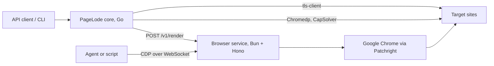
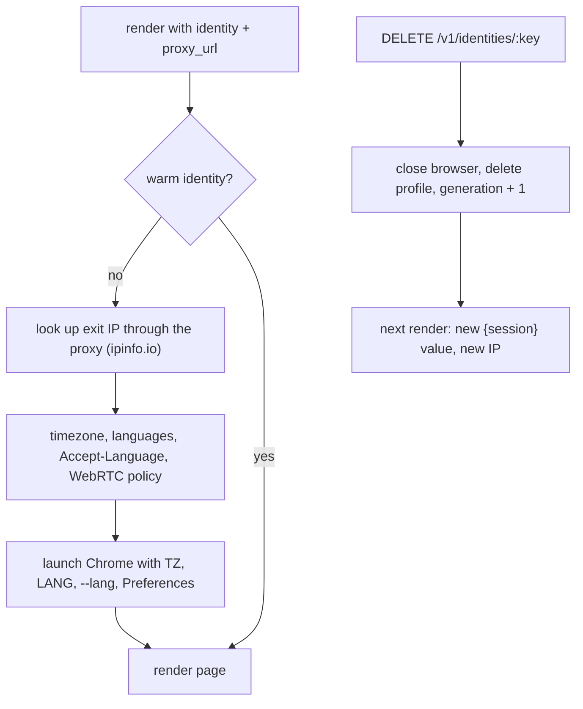

# Browser service

The browser service runs every Patchright browser for PageLode. It is a separate Bun + Hono application in [`browser-service/`](../browser-service) with its own image, so browser capacity scales independently of the Go core and agents can drive browsers directly over CDP.

## Where it fits



| Concern | Owner |
|---|---|
| HTTP tier (tls-client Chrome fingerprint), classification, extraction, route memory, escalation order, when to rotate an identity | Go core |
| Chrome processes, identities, proxies per identity, challenge settling, profiles, CDP sessions, concurrency limit, cleanup | Browser service |
| Chromedp and CapSolver | Go core for now (see [Next steps](#next-steps)) |

The service returns browser facts (HTML, status, cookies, traffic). It never decides whether a page is usable; Go classifies every result.

## Running it

| How | Command | Browser |
|---|---|---|
| Local development | `make run-browser` (or `bun src/server.ts` in `browser-service/`) | Your installed Google Chrome with a visible window |
| Docker | `docker build -t pagelode-browser-service browser-service` | Google Chrome, headed, on a virtual display |
| Both services | `BROWSER_SERVICE_TOKEN=… docker compose up` | `pagelode` calls `browser` at `http://browser:8090` |

Open `http://127.0.0.1:8090/` for the dashboard: open and close sessions, copy CDP URLs, and run test renders with a preview.

## API

Every route except `GET /healthz` and the dashboard requires the token as `Authorization: Bearer <token>` or `?token=<token>`. A token is mandatory when the service listens on a non-loopback address.

| Route | Purpose |
|---|---|
| `GET /healthz` | `{ok, active, waiting, sessions}` |
| `POST /v1/render` | Render one URL and return the page |
| `POST /v1/sessions` | Open a browser for an agent; returns a CDP URL |
| `GET /v1/sessions`, `GET /v1/sessions/:id` | List or read sessions |
| `DELETE /v1/sessions/:id` | Close a session; profile sessions save cookies first |
| `WS /v1/sessions/:id/cdp` | Browser-level CDP, relayed to that session's Chrome |
| `WS /v1/sessions/:id/devtools/page/:target` | Page-level CDP |
| `GET /v1/identities` | Warm identities with IP, country, timezone, languages, usage |
| `DELETE /v1/identities/:key` | Rotate an identity: new profile directory and new proxy session |

Errors always look like `{"error":{"code","message"}}`.

| Status | Code | When |
|---|---|---|
| 400 | `invalid_request` | Body or parameter fails validation |
| 401 | `unauthorized` | Missing or wrong token |
| 404 | `not_found`, `profile_not_found` | Unknown route, session, or profile |
| 409 | `profile_in_use`, `identity_conflict` | Profile held by a session; identity bound to another proxy or busy |
| 429 | `saturated` | Render queue full or session limit reached |
| 502 / 504 | `render_failed` | Browser error, or the render passed its hard deadline |
| 503 | `shutting_down` | Service is stopping |

### Render

| Field | Default | Notes |
|---|---|---|
| `url` | required | `http` or `https` |
| `timeout_ms` | `45000` | 1,000 to 120,000 |
| `wait_until` | `domcontentloaded` | `commit`, `domcontentloaded`, `load`, `networkidle` |
| `cookies` | `[]` | Up to 500, carried over from the Go HTTP attempt |
| `proxy_url` | none | `http`, `https`, `socks4`, `socks5`; may contain `{session}` |
| `settle_challenge` | `true` | Detect a challenge page, click its checkbox, wait for it to clear |
| `capture` | none | `{wait_ms}` adds captured network traffic to the response |
| `profile` | none | Render inside a saved login profile |
| `identity` | derived | Which warm browser identity to use (see below) |

The response contains `status_code`, `final_url`, `title`, `html` (the DOM after JavaScript), `user_agent`, `cookies`, and `traffic` when captured.

- After navigation the service waits 500 ms, or `capture.wait_ms`, before reading the page.
- Every render has a hard deadline of `timeout_ms` + 15 s. When it expires the identity's browser is discarded and relaunched on the next request, so a crashed Chrome cannot hang the queue.
- Renders beyond `BROWSER_SERVICE_CONCURRENCY` queue; beyond `BROWSER_SERVICE_MAX_WAITING` they get `429`.

### Sessions for agents

`POST /v1/sessions` accepts `proxy_url`, `profile`, `create_profile`, `headless`, `ttl_seconds` (30 to 86,400, default 900), and `start_url`. Each session is its own Chrome process with its own profile directory and a debugging port bound to `127.0.0.1` inside the service; agents reach it only through the authenticated relay.

```js
import { chromium } from "patchright";

const session = await fetch("http://127.0.0.1:8090/v1/sessions", {
  method: "POST",
  headers: { authorization: `Bearer ${token}`, "content-type": "application/json" },
  body: JSON.stringify({ start_url: "https://example.com" }),
}).then((response) => response.json());

const browser = await chromium.connectOverCDP(`${session.cdp_url}?token=${token}`);
```

- Sessions expire after `ttl_seconds`. Closing deletes anonymous profile directories.
- Attach with Patchright or Playwright running on **Node**. Bun's Playwright client cannot `connectOverCDP`, even directly to Chrome.
- A raw CDP client gets Chrome as-is; Patchright's evasions apply only when the client is Patchright.

### Profiles

`pagelode profile login <name> <URL>` opens a headed profile session (one-hour lifetime), prints its CDP URL, and waits for Enter. Closing the session saves the cookies to `BROWSER_SERVICE_PROFILES_DIR/<name>`. Later renders and captures with `profile` reuse that login. Only one owner may hold a profile: renders on the same profile run one at a time, and a profile held by a session returns `409`.

## Identities and rotation

An identity is one warm Chrome with its own profile directory (cookies, storage, cache), its own sticky proxy session, and a persona that matches the proxy's location.



- **Key.** `identity` from the request; otherwise `default` without a proxy, or a hash of the proxy URL.
- **Proxy session.** `{session}` in `proxy_url` is replaced with a value derived from the identity key and generation, so each identity keeps one sticky IP and rotation gets a new one. Most residential providers take the session in the username or password.
- **Persona.** With an HTTP(S) proxy the service looks up the exit IP through that proxy. The country selects languages (for example GB gives `en-GB, en-US, en`) and the timezone comes from the lookup. They are applied natively: `TZ` and `LANG` in Chrome's environment, `--lang`, and `intl.accept_languages` in the profile. Nothing is emulated with JavaScript, because Cloudflare detects emulated values.
- **WebRTC.** With a proxy, the profile sets `webrtc.ip_handling_policy` to `disable_non_proxied_udp`, so WebRTC cannot reveal the server's real IP.
- **Pool.** Up to `BROWSER_SERVICE_MAX_IDENTITIES` browsers stay warm; the least recently used idle one is closed when a new identity is needed. Its profile stays on disk, so cookies such as `cf_clearance` survive.
- **Rotation is policy.** The service exposes the mechanism; Go decides when to rotate, for example after a host blocks an identity twice.

## Fingerprint

The Docker image runs real Google Chrome with a normal window on a virtual Linux desktop, because headless Chrome fails bot checks. Each surface below was measured inside the container with a probe page.

| Surface | How the image provides it | Measured |
|---|---|---|
| Browser | Google Chrome stable, headed, driven by Patchright | `navigator.webdriver` false, real Chrome TLS (JA4 `t13d1517h2…`) and HTTP/2 fingerprint |
| Display | Xvfb at 1920×1080 | `screen` 1920×1080, colour depth 24 |
| Desktop | fluxbox with a 34 px top panel, windows maximized | usable area 1920×1046 at top 34, window at 0,34, like a GNOME desktop |
| Graphics | Mesa software rendering through ANGLE (`--use-angle=gl`) | WebGL and WebGL2 present: `ANGLE (Mesa, llvmpipe …, OpenGL 4.5)` |
| Audio | PulseAudio with virtual speakers and microphone | `enumerateDevices`: `audioinput, audiooutput` |
| Fonts | Liberation, DejaVu, Noto (incl. CJK and colour emoji), Cantarell | Linux desktop font set |
| Locale and time | Per identity from the proxy location; container `TZ` otherwise | `Intl` timezone and locale match the exit IP |

Some values are the same for every identity in one container: canvas and audio hashes, the WebGL renderer, fonts, screen, and CPU count. That matches many real users on identical hardware. The service deliberately does not add canvas noise or override values in JavaScript, since inconsistent or randomised fingerprints are themselves detectable.

## Configuration

| Variable | Default | Purpose |
|---|---|---|
| `BROWSER_SERVICE_HOST` | `127.0.0.1` | Listen address (`0.0.0.0` in Docker) |
| `BROWSER_SERVICE_PORT` | `8090` | Listen port |
| `BROWSER_SERVICE_TOKEN` | empty | Required unless the host is loopback |
| `BROWSER_SERVICE_CONCURRENCY` | `4` | Renders at once |
| `BROWSER_SERVICE_MAX_WAITING` | `100` | Queued renders before `429` |
| `BROWSER_SERVICE_MAX_SESSIONS` | `4` | Open CDP sessions |
| `BROWSER_SERVICE_MAX_IDENTITIES` | `8` | Warm render identities |
| `BROWSER_SERVICE_HEADLESS` | `false` | Headless is detectable; keep it off for protected sites |
| `BROWSER_SERVICE_CHANNEL` | `chrome` on macOS and Windows, bundled Chromium on Linux | `chrome` in the Docker image |
| `BROWSER_SERVICE_EXECUTABLE_PATH` | empty | Explicit browser binary |
| `BROWSER_SERVICE_CHROME_ARGS` | empty | Extra Chrome flags; the image sets the Mesa graphics flags |
| `BROWSER_SERVICE_PROFILES_DIR` | user config dir + `pagelode/profiles` | Saved login profiles |
| `BROWSER_SERVICE_DATA_DIR` | platform data dir | Identity profile directories |
| `BROWSER_SERVICE_DEBUG` | `false` | JSON logs for launches, navigation, challenges, identities |
| `TZ` | `Etc/UTC` (compose: `BROWSER_TZ`) | Timezone for identities without a proxy |

PageLode reaches the service through `PAGELODE_BROWSER_URL` and `PAGELODE_BROWSER_TOKEN`.

## Measured results

Measured on 18 October 2026 on an Apple M4 Pro (12 cores, 24 GB), from a UK home IP without a proxy.

### Throughput

Anonymous renders sharing one warm identity, local fixture page of about 100 KB with a JavaScript fetch:

| Renders at once | Pages/s | p50 ms | p95 ms | Peak memory MB |
|---|---|---|---|---|
| 1 | 1.71 | 584 | 596 | 571 |
| 4 | 6.45 | 619 | 638 | 920 |
| 8 | 11.44 | 700 | 717 | 1,373 |
| 16 | 20.15 | 767 | 925 | 2,347 |
| 32 | 27.54 | 1,113 | 1,374 | 4,286 |

Real sites (Wikipedia, MDN, BBC, GitHub and others): 1.1 pages/s at 1, 4.6 at 4, 7.9 at 8, with no failures.

- The fixed 500 ms post-load wait is about 85% of a single render.
- Each concurrent render adds a Chromium renderer process, about 120 MB at 32. Memory limits a box before CPU does.

### Stealth and rendering

| Site | Plain HTTP | Headless bundled Chromium | Headed Chrome, hardened container |
|---|---|---|---|
| sannysoft fingerprint table | – | fail | pass (23/23) |
| browserscan bot detection | fail | fail (Robot) | pass (Normal) |
| deviceandbrowserinfo | – | fail (bot user agent) | pass in one run; no verdict in another (timing) |
| Cloudflare challenge (scrapingcourse) | blocked | blocked | pass |
| Antibot challenge (scrapingcourse) | blocked | blocked | pass |
| Crunchbase | blocked | blocked | pass |
| Indeed UK | 403 | blocked | pass |
| Zillow | thin | 403 | pass |
| G2 | 403 | 403 | 403 |
| Glassdoor | 403 | blocked | blocked |
| JavaScript-rendered pages (3 tests) | partial | pass | pass |

## Known gaps

| Site or area | Cause | Planned fix |
|---|---|---|
| Glassdoor | A Cloudflare challenge with a custom title (`Security \| Glassdoor`, URL `__cf_chl_rt_tk=`). Challenge detection matches titles, so it returned the challenge page immediately | Detect challenges from the `cf-mitigated: challenge` header, `__cf_chl_` in the URL, and the challenge-platform script |
| nowsecure.nl | No longer a challenge page; a Turnstile-like element triggered a false positive and 45 s of clicking | Same signal-based detection; drop it from the stealth suite |
| G2 | DataDome block page (content only in scripts and a `captcha-delivery.com` frame); identical without a browser, so likely IP reputation | Detect DataDome and branch on its mode: wait for the device check, rotate or solve the captcha, rotate the IP on a ban; retest through a residential proxy |
| Late verdicts | Some pages fill in content asynchronously after the snapshot | Add `wait_for: {selector, timeout_ms}` to renders |
| Signatures in two places | The service's challenge check is a weaker copy of Go's `classify` patterns | One `signatures.json` read by both; return response headers and cookie names with every document so Go classifies on headers first, HTML second |

## Next steps

1. Signal-based challenge detection and a shared `signatures.json`, with response headers added to `page.Document` for both the HTTP tier and the service.
2. `wait_for` on renders; make the 500 ms post-load wait configurable.
3. DataDome handling and a stealth run through a residential proxy.
4. Move Chromedp and CapSolver into the service once Patchright covers plain JavaScript rendering at similar cost.
5. Update the production deployment (`hetzner-infra/apps/pagelode/compose.yaml`), which still runs the old single container.
