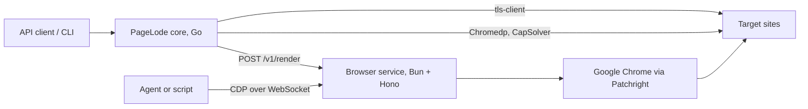
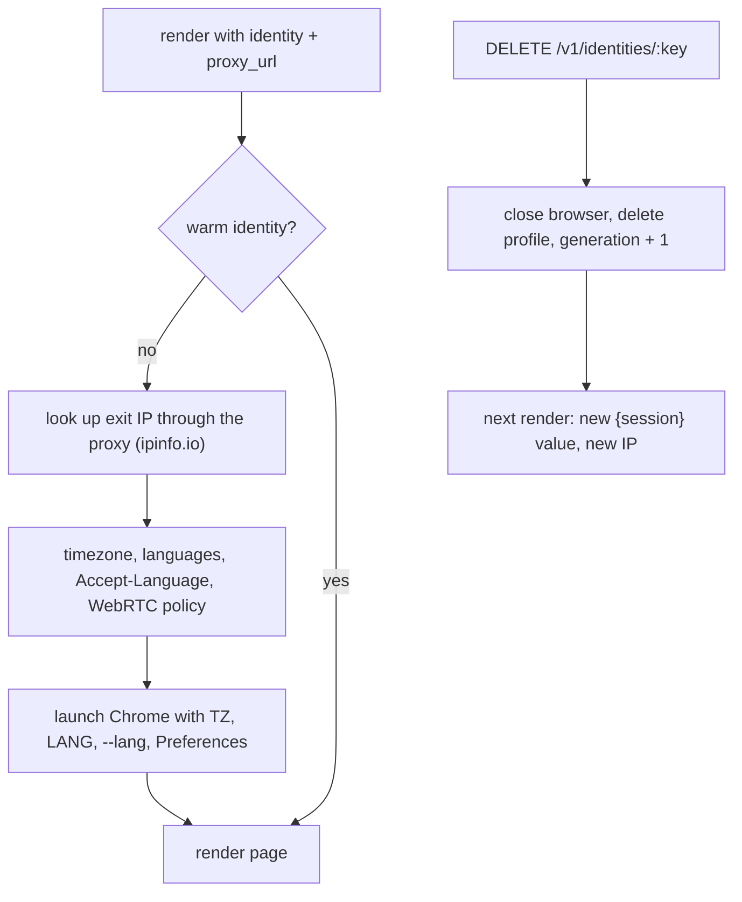
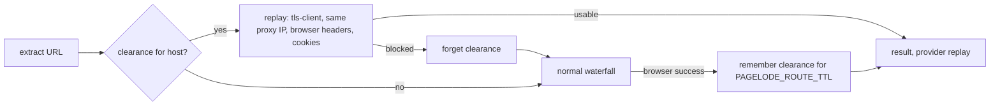

# Browser service

The browser service runs every Patchright browser for PageLode. It is a separate Bun + Hono application in [`browser-service/`](../browser-service) with its own image, so browser capacity scales independently of the Go core and agents can drive browsers directly over CDP.

## Where it fits



| Concern | Owner |
|---|---|
| HTTP tier (tls-client Chrome fingerprint), classification, extraction, route memory, escalation order, when to rotate an identity | Go core |
| Chrome processes, identities, proxies per identity, challenge settling, profiles, CDP sessions, concurrency limit, cleanup | Browser service |
| Chromedp and CapSolver | Go core for now (see [Next steps](#next-steps)) |

The service returns browser facts (HTML, status, cookies, traffic). It never decides whether a page is usable; Go classifies every result.

## Running it

| How | Command | Browser |
|---|---|---|
| Local development | `make run-browser` (or `bun src/server.ts` in `browser-service/`) | Your installed Google Chrome with a visible window |
| Docker | `docker build -t pagelode-browser-service browser-service` | Google Chrome, headed, on a virtual display |
| Both services | `BROWSER_SERVICE_TOKEN=… docker compose up` | `pagelode` calls `browser` at `http://browser:8090` |

Open `http://127.0.0.1:8090/` for the dashboard: open and close sessions, copy CDP URLs, and run test renders with a preview.

## Source layout

Each feature folder owns its routes, request schema, and logic. `app.ts` only composes them.

| Path | Owns |
|---|---|
| `src/server.ts` | Entry point: config, wiring, `Bun.serve`, graceful shutdown |
| `src/app.ts` | Hono app: error format, health, auth, body limit, feature routers under `/v1`, dashboard |
| `src/config.ts` | `BROWSER_SERVICE_*` environment |
| `src/render/` | `POST /v1/render`: `schema.ts`, `renderer.ts` (identity or profile, limiter, deadline), `page.ts` (one page render), `challenge.ts` (settling), `capture.ts` (network capture), `replay.ts` (headers and cookies for HTTP replay) |
| `src/captcha/` | `datadome.ts` (DataDome device check, CapSolver fallback), `google.ts` (Google's `/sorry` reCAPTCHA through CapSolver), `capsolver.ts` (CapSolver task client) |
| `src/sessions/` | `/v1/sessions` and the CDP relay: `schema.ts`, `sessions.ts` (lifecycle), `devtools.ts` (debug port, endpoint discovery, WebSocket relay) |
| `src/identities/` | `/v1/identities`: `pool.ts` (warm identities, rotation) |
| `src/profiles/` | `store.ts` (profile directories and saved cookies), `locks.ts` (one owner per profile) |
| `src/browser/` | `launch.ts` (the single Chrome launch path), `persona.ts` (geo lookup, languages, timezone, WebRTC preferences, proxy sessions) |
| `src/shared/` | `errors.ts`, `schemas.ts` (shared field validators), `http.ts` (token check), `limiter.ts`, `log.ts` |
| `public/` | Dashboard (static HTML, CSS, and JavaScript) |
| `desktop/`, `docker-entrypoint.sh` | Virtual desktop for the container: fluxbox and PulseAudio configuration |

## API

Every route except `GET /healthz` and the dashboard requires the token as `Authorization: Bearer <token>` or `?token=<token>`. A token is mandatory when the service listens on a non-loopback address.

| Route | Purpose |
|---|---|
| `GET /healthz` | `{ok, active, waiting, sessions}` |
| `POST /v1/render` | Render one URL and return the page |
| `POST /v1/sessions` | Open a browser for an agent; returns a CDP URL |
| `GET /v1/sessions`, `GET /v1/sessions/:id` | List or read sessions |
| `DELETE /v1/sessions/:id` | Close a session; profile sessions save cookies first |
| `WS /v1/sessions/:id/cdp` | Browser-level CDP, relayed to that session's Chrome |
| `WS /v1/sessions/:id/devtools/page/:target` | Page-level CDP |
| `GET /v1/identities` | Warm identities with IP, country, timezone, languages, usage |
| `GET /v1/identities/:key/clearance?url=` | The identity's exact proxy URL, browser request headers, and cookies for that URL, for replay over HTTP |
| `DELETE /v1/identities/:key` | Rotate an identity: new profile directory and new proxy session |

Errors always look like `{"error":{"code","message"}}`.

| Status | Code | When |
|---|---|---|
| 400 | `invalid_request` | Body or parameter fails validation |
| 401 | `unauthorized` | Missing or wrong token |
| 404 | `not_found`, `profile_not_found` | Unknown route, session, or profile |
| 409 | `profile_in_use`, `identity_conflict` | Profile held by a session; identity bound to another proxy or busy |
| 429 | `saturated` | Render queue full or session limit reached |
| 502 / 504 | `render_failed` | Browser error, or the render passed its hard deadline |
| 503 | `shutting_down` | Service is stopping |

### Render

| Field | Default | Notes |
|---|---|---|
| `url` | required | `http` or `https` |
| `timeout_ms` | `45000` | 1,000 to 120,000 |
| `wait_until` | `domcontentloaded` | `commit`, `domcontentloaded`, `load`, `networkidle` |
| `cookies` | `[]` | Up to 500, carried over from the Go HTTP attempt |
| `proxy_url` | none | `http`, `https`, `socks4`, `socks5`; may contain `{session}` |
| `settle_challenge` | `true` | Detect a challenge page, click its checkbox, wait for it to clear |
| `solve_captcha` | `true` | Clear DataDome (wait for its device check, then CapSolver) and Google's `/sorry` reCAPTCHA (CapSolver) when configured |
| `capture` | none | `{wait_ms}` adds captured network traffic to the response |
| `profile` | none | Render inside a saved login profile |
| `identity` | derived | Which warm browser identity to use (see below) |

The response contains `status_code`, `final_url`, `title`, `html` (the DOM after JavaScript), `user_agent`, `cookies`, `replay`, and `traffic` when captured. `replay` holds the identity key, the exact proxy URL with `{session}` filled in, and Chrome's own request headers (`user-agent`, `accept`, `accept-language`, `sec-ch-ua`, `sec-ch-ua-mobile`, `sec-ch-ua-platform`).

- After navigation the service waits 500 ms, or `capture.wait_ms`, before reading the page.
- Every render has a hard deadline of `timeout_ms` + 15 s. When it expires the identity's browser is discarded and relaunched on the next request, so a crashed Chrome cannot hang the queue.
- Renders beyond `BROWSER_SERVICE_CONCURRENCY` queue; beyond `BROWSER_SERVICE_MAX_WAITING` they get `429`.

### Sessions for agents

`POST /v1/sessions` accepts `proxy_url`, `profile`, `create_profile`, `headless`, `ttl_seconds` (30 to 86,400, default 900), and `start_url`. Each session is its own Chrome process with its own profile directory and a debugging port bound to `127.0.0.1` inside the service; agents reach it only through the authenticated relay.

```js
import { chromium } from "patchright";

const session = await fetch("http://127.0.0.1:8090/v1/sessions", {
  method: "POST",
  headers: { authorization: `Bearer ${token}`, "content-type": "application/json" },
  body: JSON.stringify({ start_url: "https://example.com" }),
}).then((response) => response.json());

const browser = await chromium.connectOverCDP(`${session.cdp_url}?token=${token}`);
```

- Sessions expire after `ttl_seconds`. Closing deletes anonymous profile directories.
- Attach with Patchright or Playwright running on **Node**. Bun's Playwright client cannot `connectOverCDP`, even directly to Chrome.
- A raw CDP client gets Chrome as-is; Patchright's evasions apply only when the client is Patchright.

### Profiles

`pagelode profile login <name> <URL>` opens a headed profile session (one-hour lifetime), prints its CDP URL, and waits for Enter. Closing the session saves the cookies to `BROWSER_SERVICE_PROFILES_DIR/<name>`. Later renders and captures with `profile` reuse that login. Only one owner may hold a profile: renders on the same profile run one at a time, and a profile held by a session returns `409`.

## Identities and rotation

An identity is one warm Chrome with its own profile directory (cookies, storage, cache), its own sticky proxy session, and a persona that matches the proxy's location.



- **Key.** `identity` from the request; otherwise `default` without a proxy, or a hash of the proxy URL.
- **Proxy session.** `{session}` in `proxy_url` is replaced with a value derived from the identity key and generation, so each identity keeps one sticky IP and rotation gets a new one. Most residential providers take the session in the username or password.
- **Persona.** With an HTTP(S) proxy the service looks up the exit IP through that proxy. The country selects languages (for example GB gives `en-GB, en-US, en`) and the timezone comes from the lookup. They are applied natively: `TZ` and `LANG` in Chrome's environment, `--lang`, and `intl.accept_languages` in the profile. Nothing is emulated with JavaScript, because Cloudflare detects emulated values.
- **WebRTC.** With a proxy, the profile sets `webrtc.ip_handling_policy` to `disable_non_proxied_udp`, so WebRTC cannot reveal the server's real IP.
- **Pool.** Up to `BROWSER_SERVICE_MAX_IDENTITIES` browsers stay warm; the least recently used idle one is closed when a new identity is needed. Its profile stays on disk, so cookies such as `cf_clearance` survive.
- **Rotation is policy.** The service exposes the mechanism; Go decides when to rotate, for example after a host blocks an identity twice.

## Clearance replay

A browser render earns a site's clearance once: cookies such as Cloudflare's `cf_clearance`, DataDome's `datadome`, or Google's session cookies. PageLode then reuses that clearance over its cheap tls-client loader for later requests to the same host.



| Replayed | Source |
|---|---|
| Exit IP | The identity's exact proxy URL from `replay.proxy_url` |
| Cookies | Every cookie in the identity's browser after the render |
| User agent and client hints | Chrome's real request headers from the main document request |
| Header order | Chrome's navigation order, including `sec-fetch-*` and `priority` |
| TLS handshake | tls-client's newest Chrome profile (`Chrome_152`) |

- PageLode keeps clearances in memory per host (`internal/memory/clearances.go`) for `PAGELODE_ROUTE_TTL` and tries replay before the waterfall.
- A blocked replay forgets the clearance and runs the normal waterfall, which harvests a fresh one.
- Replayed results report provider `replay`.
- Other tools can read the same data from `GET /v1/identities/:key/clearance`.

## Fingerprint

The Docker image runs real Google Chrome with a normal window on a virtual Linux desktop, because headless Chrome fails bot checks. Each surface below was measured inside the container with a probe page.

| Surface | How the image provides it | Measured |
|---|---|---|
| Browser | Google Chrome stable, headed, driven by Patchright | `navigator.webdriver` false, real Chrome TLS (JA4 `t13d1517h2…`) and HTTP/2 fingerprint |
| Display | Xvfb at 1920×1080 | `screen` 1920×1080, colour depth 24 |
| Desktop | fluxbox with a 34 px top panel, windows maximized | usable area 1920×1046 at top 34, window at 0,34, like a GNOME desktop |
| Graphics | Mesa software rendering through ANGLE (`--use-angle=gl`) | WebGL and WebGL2 present: `ANGLE (Mesa, llvmpipe …, OpenGL 4.5)` |
| Audio | PulseAudio with virtual speakers and microphone | `enumerateDevices`: `audioinput, audiooutput` |
| Fonts | Liberation, DejaVu, Noto (incl. CJK and colour emoji), Cantarell | Linux desktop font set |
| Locale and time | Per identity from the proxy location; container `TZ` otherwise | `Intl` timezone and locale match the exit IP |

Some values are the same for every identity in one container: canvas and audio hashes, the WebGL renderer, fonts, screen, and CPU count. That matches many real users on identical hardware. The service deliberately does not add canvas noise or override values in JavaScript, since inconsistent or randomised fingerprints are themselves detectable.

## Configuration

| Variable | Default | Purpose |
|---|---|---|
| `BROWSER_SERVICE_HOST` | `127.0.0.1` | Listen address (`0.0.0.0` in Docker) |
| `BROWSER_SERVICE_PORT` | `8090` | Listen port |
| `BROWSER_SERVICE_TOKEN` | empty | Required unless the host is loopback |
| `BROWSER_SERVICE_CONCURRENCY` | `4` | Renders at once |
| `BROWSER_SERVICE_MAX_WAITING` | `100` | Queued renders before `429` |
| `BROWSER_SERVICE_MAX_SESSIONS` | `4` | Open CDP sessions |
| `BROWSER_SERVICE_MAX_IDENTITIES` | `8` | Warm render identities |
| `BROWSER_SERVICE_HEADLESS` | `false` | Headless is detectable; keep it off for protected sites |
| `BROWSER_SERVICE_CHANNEL` | `chrome` on macOS and Windows, bundled Chromium on Linux | `chrome` in the Docker image |
| `BROWSER_SERVICE_EXECUTABLE_PATH` | empty | Explicit browser binary |
| `BROWSER_SERVICE_CHROME_ARGS` | empty | Extra Chrome flags; the image sets the Mesa graphics flags |
| `BROWSER_SERVICE_PROFILES_DIR` | user config dir + `pagelode/profiles` | Saved login profiles |
| `BROWSER_SERVICE_DATA_DIR` | platform data dir | Identity profile directories |
| `BROWSER_SERVICE_DEBUG` | `false` | JSON logs for launches, navigation, challenges, identities |
| `TZ` | `Etc/UTC` (compose: `BROWSER_TZ`) | Timezone for identities without a proxy |
| `CAPSOLVER_API_KEY` | empty | Enables the CapSolver fallback for DataDome captchas |
| `CAPSOLVER_URL` | `https://api.capsolver.com` | CapSolver API base URL |

PageLode reaches the service through `PAGELODE_BROWSER_URL` and `PAGELODE_BROWSER_TOKEN`.

## Measured results

Measured on 18 October 2026 on an Apple M4 Pro (12 cores, 24 GB), from a UK home IP without a proxy.

### Throughput

Anonymous renders sharing one warm identity, local fixture page of about 100 KB with a JavaScript fetch:

| Renders at once | Pages/s | p50 ms | p95 ms | Peak memory MB |
|---|---|---|---|---|
| 1 | 1.71 | 584 | 596 | 571 |
| 4 | 6.45 | 619 | 638 | 920 |
| 8 | 11.44 | 700 | 717 | 1,373 |
| 16 | 20.15 | 767 | 925 | 2,347 |
| 32 | 27.54 | 1,113 | 1,374 | 4,286 |

Real sites (Wikipedia, MDN, BBC, GitHub and others): 1.1 pages/s at 1, 4.6 at 4, 7.9 at 8, with no failures.

- The fixed 500 ms post-load wait is about 85% of a single render.
- Each concurrent render adds a Chromium renderer process, about 120 MB at 32. Memory limits a box before CPU does.

### Stealth and rendering

| Site | Plain HTTP | Headless bundled Chromium | Headed Chrome, hardened container |
|---|---|---|---|
| sannysoft fingerprint table | – | fail | pass (23/23) |
| browserscan bot detection | fail | fail (Robot) | pass (Normal) |
| deviceandbrowserinfo | – | fail (bot user agent) | pass in one run; no verdict in another (timing) |
| Cloudflare challenge (scrapingcourse) | blocked | blocked | pass |
| Antibot challenge (scrapingcourse) | blocked | blocked | pass |
| Crunchbase | blocked | blocked | pass |
| Indeed UK | 403 | blocked | pass |
| Zillow | thin | 403 | pass |
| G2 | 403 | 403 | 403 from a home IP; pass through a mobile proxy (see below) |
| Glassdoor | 403 | blocked | blocked |
| JavaScript-rendered pages (3 tests) | partial | pass | pass |

### DataDome through a mobile proxy

Same container, fresh identities, Evomi mobile IPs in each site's country, one sequential pass. DataDome was confirmed on each site from its `x-datadome` header and `datadome` cookie.

| Site | Proxy | Status | Title | Visible text | Time |
|---|---|---|---|---|---|
| leboncoin | FR | 200 | « velo » Toute la France - leboncoin | 10.0k chars | 6.7 s |
| seloger | FR | 200 | Petites annonces immobilières | 8.1k | 2.8 s |
| vinted | FR | 200 | Articles \| Vinted | 6.4k | 5.7 s |
| tripadvisor | GB | 200 | THE 10 BEST Hotels in London 2026 | 30.8k | 15.1 s |
| thefork | GB | 200 | TheFork – Book the best restaurants | 8.5k | 7.9 s |
| idealista | ES | 200 | Casas y pisos en Madrid — idealista | 30.8k | 8.5 s |
| allegro | PL | 200 | Rower - Niska cena na Allegro | 42.0k | 19.0 s |
| yelp | US | 200 | TOP 10 BEST Pizza in San Francisco, CA | 17.6k | 26.8 s |
| etsy | US | 200 | Ceramic mug - Etsy | 26.7k | 23.6 s |
| g2 | US | 200 | Best CRM Software: User Reviews | 56.8k | 22.9 s |

- Every DataDome site answered the first request with its device check (`rt:'i'`). Real headed Chrome on a mobile IP passed it without solving anything, and the identity kept the `datadome` cookie, so later pages loaded directly.
- Plain HTTP through the same mobile IPs got the slider captcha (`rt:'c'`) on every site; the browser from a home IP also got the captcha.
- CapSolver was never needed. The fallback is wired but not yet exercised end to end, and CapSolver only accepts Windows or Mac Chrome and Firefox user agents, so it is unlikely to work from the Linux container.

### Google search with clearance replay

PageLode with the container service, Evomi mobile proxies, `PAGELODE_CHROMEDP_ENABLED=false`.

| Step | Path | Result | Time |
|---|---|---|---|
| First search | tls-client gets Google's JavaScript wall, then the browser renders (CapSolver solves `/sorry` when served) | Results | 7–17 s, up to 63 s with a slow solve |
| Next 47 searches, one session | `replay` | 45 with results, 2 blocked and re-harvested by the browser | 1.1–1.9 s each |
| Reproducibility run, rounds 1–3 (GB, GB, US), fresh identity and PageLode restart per round | 1 harvest + 15 replays per round | 46 of 48 searches returned results; every search after a successful harvest replayed | replays 1.1–1.9 s |

- Plain tls-client always receives Google's JavaScript wall (`emsg=SG_REL`); `classify` now treats it as blocked.
- US T-Mobile IPs (`172.56.*`) received `/sorry` on every query; GB, IE, and AU IPs often did not.
- Result links are opaque `google.com/goto?url=` tokens. The `cite` element shows the host and a shortened path; the real URL needs one extra request per result.

### Google: which cookie the replay needs

Three fresh harvests (IE, GB, GB) replayed with one change at a time, two rounds each, the full session as a control at the start and end of every round. The control returned results 12 of 12 times.

| Variant | IE-1 | GB-0 | GB-2 (harvest hit `/sorry`) |
|---|---|---|---|
| Full session (control) | results | results | results |
| No cookies | wall | wall | wall |
| Drop `AEC` | results | results | results |
| Drop `SEARCH_SAMESITE` | results | results | results |
| Drop `__Secure-ENID` | wall | wall | wall |
| Only `__Secure-ENID` | results | results | `/sorry` |
| Only `AEC` | wall | wall | wall |
| Same cookie names minted by a plain HTTP request | wall | wall | wall |
| Plain headers (no browser headers) | results | results | results |
| No `sec-ch-ua` client hints | results | results | results |
| Older TLS profile (`Chrome_150`) | results | results | results |
| Drop `GOOGLE_ABUSE_EXEMPTION` | – | – | `/sorry` |
| Only `GOOGLE_ABUSE_EXEMPTION` | – | – | wall |

- **`__Secure-ENID` is the clearance.** It lives about 395 days; `AEC` and `SEARCH_SAMESITE` are not needed.
- **Only the browser-minted value works.** A plain HTTP request also receives `__Secure-ENID`, but that value still gets the wall. The browser's value is longer (about 370–410 characters), consistent with Google upgrading it once its page JavaScript runs.
- **Headers and TLS profile did not matter** in this test.
- **A harvest that solved `/sorry` also needs `GOOGLE_ABUSE_EXEMPTION`**, a short-lived cookie that must be sent together with `__Secure-ENID`.

Replaying only `__Secure-ENID` from other networks, three searches each:

| Session | Same IP | New IP, same country | New IP, other country | Home IP, no proxy |
|---|---|---|---|---|
| IE-1 (`80.233.63.57`) | results | results (`80.233.37.160`) | `/sorry` | `/sorry` |
| GB-0 (`82.132.233.175`) | results | `/sorry` (`31.94.2.127`) | `/sorry` | `/sorry` |

The token worked from another IP in the same `80.233.x.x` range but not from a different GB range. This suggests it is bound to a network or IP range rather than one address, but two sessions are not enough to be sure, and a `/sorry` on a new IP may mean that IP was already flagged. Replay from the harvesting IP until this is measured further.

### Google: harvest and replay volume

One laptop-sized container, `BROWSER_SERVICE_CONCURRENCY=10`, Evomi mobile IPs in GB, IE, and AU, one identity per IP.

| Step | Result |
|---|---|
| Harvest 20 sessions, 8 at a time | 20 of 20 in 54 s (about 22 per minute); 3.5–41 s each, slower when `/sorry` was solved |
| Replay all 20 in parallel for 3 minutes, one search every 3 s per cookie | 677 of 728 searches returned results (93%), **3.76 searches/s**, 1–1.2 s latency on GB and IE, about 2.2 s on AU |
| Life of a cookie at that pace | 8 cookies never blocked; 10 blocked after 39–40 searches (about 2.5 minutes); 3 blocked early (after 0, 2, and 14) |
| Results page size | 617 KB decompressed, about 188 KB gzip-compressed (local estimate) |

- The block at about 40 searches is either a per-session count or a time window; this run cannot tell them apart because every cookie used the same pace.
- At 188 KB per search, 300 searches/s is about 4.9 TB of proxy traffic per day, which makes bandwidth the main cost at Serper-like volume ([Serper](https://serper.dev/) sells 50–300 queries per second at $1.00–$0.30 per 1,000).

## Known gaps

| Site or area | Cause | Planned fix |
|---|---|---|
| Glassdoor | A Cloudflare challenge with a custom title (`Security \| Glassdoor`, URL `__cf_chl_rt_tk=`). Challenge detection matches titles, so it returned the challenge page immediately | Detect challenges from the `cf-mitigated: challenge` header, `__cf_chl_` in the URL, and the challenge-platform script |
| nowsecure.nl | No longer a challenge page; a Turnstile-like element triggered a false positive and 45 s of clicking | Same signal-based detection; drop it from the stealth suite |
| DataDome captchas | Device checks pass; the slider captcha only appears for distrusted IPs or non-browser clients. CapSolver accepts only Windows or Mac user agents | Rotate the identity to a fresh IP first; exercise the CapSolver fallback on a Mac or Windows service |
| Late verdicts | Some pages fill in content asynchronously after the snapshot | Add `wait_for: {selector, timeout_ms}` to renders |
| Signatures in two places | The service's challenge check is a weaker copy of Go's `classify` patterns | One `signatures.json` read by both; return response headers and cookie names with every document so Go classifies on headers first, HTML second |
| Render deadline with CapSolver | A render is limited to `timeout_ms` + 15 s, and PageLode caps `timeout_ms` at 45 s, so a slow captcha solve exceeds it and the browser is discarded | Add the CapSolver solving budget to the deadline when a solver is configured |
| Browser closed at startup | A freshly launched identity occasionally died on its first page (`Target page, context or browser has been closed`) | Discard and retry once on a fresh browser within the same deadline |
| Identity rotation can hang | During the reproducibility run a `DELETE /v1/identities/:key` never returned, stalling the run after round 3 | Bound `context.close()` with a timeout and kill the browser process if it does not exit |
| One identity per PageLode proxy | PageLode sends no `identity`, so all its renders share one browser and IP, and Go never rotates | Let Go keep a pool of identities per country and rotate on repeated blocks |

## Next steps

1. Fix the render deadline with CapSolver, the startup retry, and bounded rotation; repeat the 10-round Google reproducibility run.
2. Signal-based challenge detection and a shared `signatures.json`, with response headers added to `page.Document` for both the HTTP tier and the service.
3. `wait_for` on renders; make the 500 ms post-load wait configurable.
4. A Google search endpoint: identity pool per country, result parsing, `/goto` link resolution.
5. Move Chromedp and CapSolver into the service once Patchright covers plain JavaScript rendering at similar cost.
6. Update the production deployment (`hetzner-infra/apps/pagelode/compose.yaml`), which still runs the old single container.
