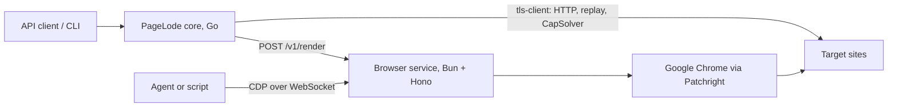
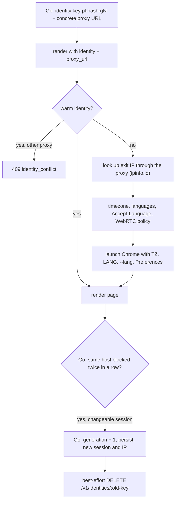
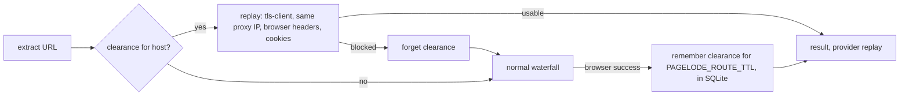

# Browser service

The browser service runs every browser for PageLode; Go has no browser of its own. It is a separate Bun + Hono application in [`browser-service/`](../browser-service) with its own image, so browser capacity scales independently of the Go core and agents can drive browsers directly over CDP.

## Where it fits



| Concern | Owner |
|---|---|
| HTTP tier (tls-client Chrome fingerprint), classification, extraction, route memory and clearances (persisted in SQLite), escalation order, identity keys, proxy sessions, when to rotate an identity, every CapSolver task (Cloudflare, Google `/sorry`, DataDome slider) | Go core |
| Chrome processes, identities bound to a proxy, challenge settling, DataDome device-check wait, challenge facts, profiles, CDP sessions, concurrency limit, cleanup | Browser service |
| Block patterns and challenge signals | Shared: [`signatures/signatures.json`](../signatures/signatures.json), read by both |

The service holds no CapSolver key. A render that ends on a captcha returns that page with a `challenge` fact; Go solves it (see [Captchas](#captchas)) and renders again with the solved cookie.

The service returns browser facts (HTML, status, headers, cookies, a remaining challenge, traffic). It never decides whether a page is usable; Go classifies every result.

## Running it

| How | Command | Browser |
|---|---|---|
| Local development | `make run-browser` (or `bun src/server.ts` in `browser-service/`) | Your installed Google Chrome with a visible window |
| Docker | `docker build -f browser-service/Dockerfile -t pagelode-browser-service .` from the repository root, so the image can copy `signatures/` | Google Chrome, headed, on a virtual display |
| Both services | `BROWSER_SERVICE_TOKEN=… docker compose up` | `pagelode` calls `browser` at `http://browser:8090` |

Open `http://127.0.0.1:8090/` for the dashboard: open and close sessions, copy CDP URLs, and run test renders with a preview.

## Source layout

Each feature folder owns its routes, request schema, and logic. `app.ts` only composes them.

| Path | Owns |
|---|---|
| `src/server.ts` | Entry point: config, wiring, `Bun.serve`, graceful shutdown |
| `src/app.ts` | Hono app: error format, health, auth, body limit, feature routers under `/v1`, dashboard |
| `src/config.ts` | `BROWSER_SERVICE_*` environment |
| `src/render/` | `POST /v1/render`: `schema.ts`, `renderer.ts` (identity or profile, limiter, deadline), `page.ts` (one page render, settle, `wait_for`, headers), `challenge.ts` (signal-based detection and settling from `signatures.json`), `datadome.ts` (waits for DataDome's device check), `capture.ts` (network capture), `replay.ts` (headers and cookies for HTTP replay) |
| `src/sessions/` | `/v1/sessions` and the CDP relay: `schema.ts`, `sessions.ts` (lifecycle), `devtools.ts` (debug port, endpoint discovery, WebSocket relay) |
| `src/identities/` | `/v1/identities`: `pool.ts` (warm identities bound to a proxy), `routes.ts` |
| `src/profiles/` | `store.ts` (profile directories and saved cookies), `locks.ts` (one owner per profile) |
| `src/browser/` | `launch.ts` (the single Chrome launch path), `persona.ts` (geo lookup, languages, timezone, WebRTC preferences) |
| `src/shared/` | `errors.ts`, `schemas.ts` (shared field validators), `http.ts` (token check), `limiter.ts`, `log.ts` |
| `public/` | Dashboard (static HTML, CSS, and JavaScript) |
| `desktop/`, `docker-entrypoint.sh` | Virtual desktop for the container: fluxbox and PulseAudio configuration |

## API

Every route except `GET /healthz` and the dashboard requires the token as `Authorization: Bearer <token>` or `?token=<token>`. A token is mandatory when the service listens on a non-loopback address.

| Route | Purpose |
|---|---|
| `GET /healthz` | `{ok, active, waiting, sessions}` |
| `POST /v1/render` | Render one URL and return the page |
| `POST /v1/sessions` | Open a browser for an agent; returns a CDP URL |
| `GET /v1/sessions`, `GET /v1/sessions/:id` | List or read sessions |
| `DELETE /v1/sessions/:id` | Close a session; profile sessions save cookies first |
| `WS /v1/sessions/:id/cdp` | Browser-level CDP, relayed to that session's Chrome |
| `WS /v1/sessions/:id/devtools/page/:target` | Page-level CDP |
| `GET /v1/identities` | Warm identities with IP, country, timezone, languages, usage |
| `GET /v1/identities/:key/clearance?url=` | The identity's exact proxy URL, browser request headers, and cookies for that URL, for replay over HTTP |
| `DELETE /v1/identities/:key` | Close the identity's browser and wipe its profile directory. `409` while renders are in progress; an unknown key is a no-op |

Errors always look like `{"error":{"code","message"}}`.

| Status | Code | When |
|---|---|---|
| 400 | `invalid_request` | Body or parameter fails validation, including a `proxy_url` that contains `{session}` |
| 401 | `unauthorized` | Missing or wrong token |
| 404 | `not_found`, `profile_not_found` | Unknown route, session, or profile |
| 409 | `profile_in_use`, `identity_conflict` | Profile held by a session; identity bound to another proxy or has renders in progress |
| 429 | `saturated` | Render queue full or session limit reached |
| 502 / 504 | `render_failed` | Browser error, or the render passed its hard deadline |
| 503 | `shutting_down` | Service is stopping |

### Render

| Field | Default | Notes |
|---|---|---|
| `url` | required | `http` or `https` |
| `timeout_ms` | `45000` | 1,000 to 120,000 |
| `wait_until` | `domcontentloaded` | `commit`, `domcontentloaded`, `load`, `networkidle` |
| `cookies` | `[]` | Up to 500, carried over from the Go HTTP attempt |
| `proxy_url` | none | `http`, `https`, `socks4`, `socks5`. Must be concrete: `{session}`, `%7Bsession%7D`, or `%7bsession%7d` is rejected with `400` |
| `settle_challenge` | `true` | When the page shows a [challenge hint](#challenge-detection), detect a challenge page, click its checkbox, and wait for it to clear |
| `solve_captcha` | `true` | When the page shows a challenge hint, wait up to 15 s for DataDome's device check to pass. The service solves no captchas itself |
| `settle_ms` | `2000` | 0 to 10,000. Longest wait for the page to go quiet after load (see [Waiting for the page](#waiting-for-the-page)); `0` skips it |
| `wait_for` | none | `{selector, timeout_ms}`; `timeout_ms` 100 to 30,000, default 10,000. After settling, waits for an attached element; a timeout does not fail the render |
| `capture` | none | `{wait_ms, max_requests, max_body_bytes, max_total_bytes}` adds captured network traffic. `wait_ms` replaces `settle_ms` as the longest quiet wait. Limits: requests 1–200 (default 200), bytes per body 1–262,144 (default 262,144), total body bytes 1–2,097,152 (default 2,097,152) |
| `profile` | none | Render inside a saved login profile |
| `identity` | derived | Which warm browser identity to use (see below) |

The response contains `status_code`, `final_url`, `title`, `html` (the DOM after JavaScript), `user_agent`, `headers`, `cookies`, `replay`, and, when present, `challenge`, `wait_for_matched`, and `traffic`.

- `headers` are the response headers of the last main-frame document.
- `challenge` is set when a challenge remains after settling: `{vendor, url?, sitekey?, data_s?}` with `vendor` `cloudflare`, `datadome` (with the captcha frame `url`), or `recaptcha` (with `sitekey` and `data_s`). Only pages with a challenge hint are checked, so pages without one never carry `challenge`.
- `wait_for_matched` is returned only when `wait_for` was sent.
- `replay` holds the identity key, the exact proxy URL, and Chrome's own request headers (`user-agent`, `accept`, `accept-language`, `sec-ch-ua`, `sec-ch-ua-mobile`, `sec-ch-ua-platform`).
- Every render has a hard deadline of `timeout_ms` + 15 s. When it expires the identity's browser is discarded and relaunched on the next request, so a crashed Chrome cannot hang the queue.
- Renders beyond `BROWSER_SERVICE_CONCURRENCY` queue; beyond `BROWSER_SERVICE_MAX_WAITING` they get `429`. This is the only browser limit; Go maps `429 saturated` to `limit.ErrSaturated`.

Go always sends `settle_ms` (from `PAGELODE_BROWSER_SETTLE_MS`) and its capture limits (`page.MaxCapture*`: 200 requests, 256 KiB, 2 MiB). Anonymous Go renders also send an `identity` key and a concrete `proxy_url`.

### Waiting for the page

After navigation (and after any challenge settling and `wait_for`), the service waits until the page goes quiet, up to `settle_ms` (or `capture.wait_ms`) (`src/render/activity.ts`):

- **Quiet** means 200 ms with no `document`, `script`, `xhr`, or `fetch` request in flight and no DOM change (child list or text; attributes are ignored, so animations do not keep a page busy).
- **Measured from the start of the wait**, so a page always gets at least 200 ms of observation after load.
- **Images, fonts, stylesheets, and media are ignored**; they do not change the extracted text.
- **DOM changes** are counted by a `MutationObserver` that Patchright runs in an isolated world, polled every 50 ms; the page cannot see it.
- **Never quiet** (polling, streaming) means the full `settle_ms` cap.

### Challenge detection

Challenge work runs only when the page shows a **hint**, checked once after navigation from cheap facts (`challenge_hint` in the debug log):

| Hint | Source |
|---|---|
| Main document status `401`, `403`, `429`, or `503` | `challenge.hint_statuses` |
| An `x-datadome` response header | `challenge.hint_headers` |
| The `cf-mitigated: challenge` header | `challenge.headers` |
| A `__cf_chl_` URL marker | `challenge.url_contains` |
| A challenge title such as "Just a moment" | `challenge.titles` |

Without a hint the service skips Cloudflare settling, the DataDome device-check wait, and the final challenge report, so it never copies the page text out of the browser. With a hint it runs the full checks: the signals above plus a body text list and selectors (`#challenge-form`, the challenge-platform form, the orchestrate script). `.cf-turnstile` and the Turnstile iframe are click targets only, not detection signals. DataDome and reCAPTCHA use `captchas.datadome_frame` and `captchas.recaptcha_widget`.

### Sessions for agents

`POST /v1/sessions` accepts `proxy_url`, `profile`, `create_profile`, `headless`, `ttl_seconds` (30 to 86,400, default 900), and `start_url`. Each session is its own Chrome process with its own profile directory and a debugging port bound to `127.0.0.1` inside the service; agents reach it only through the authenticated relay.

```js
import { chromium } from "patchright";

const session = await fetch("http://127.0.0.1:8090/v1/sessions", {
  method: "POST",
  headers: { authorization: `Bearer ${token}`, "content-type": "application/json" },
  body: JSON.stringify({ start_url: "https://example.com" }),
}).then((response) => response.json());

const browser = await chromium.connectOverCDP(`${session.cdp_url}?token=${token}`);
```

- Sessions expire after `ttl_seconds`. Closing deletes anonymous profile directories.
- Attach with Patchright or Playwright running on **Node**. Bun's Playwright client cannot `connectOverCDP`, even directly to Chrome.
- A raw CDP client gets Chrome as-is; Patchright's evasions apply only when the client is Patchright.

### Profiles

`pagelode profile login <name> <URL>` opens a headed profile session (one-hour lifetime), prints its CDP URL, and waits for Enter. Closing the session saves the cookies to `BROWSER_SERVICE_PROFILES_DIR/<name>`. Later renders and captures with `profile` reuse that login. Only one owner may hold a profile: renders on the same profile run one at a time, and a profile held by a session returns `409`.

## Identities and rotation

An identity is one warm Chrome with its own profile directory (cookies, storage, cache), bound to one exact proxy URL, and a persona that matches the proxy's location. Go owns the keys and proxy sessions; the service only binds them.



- **Key in the service.** `identity` from the request; otherwise `default` without a proxy, or `proxy-<hash of the proxy URL>`. `acquire(key, proxy)` binds a key to its proxy; a different proxy for the same key returns `409`. The profile directory is `identity-<hash of key>`. There are no generations in the service.
- **Key in Go** (`internal/browser/identity.go`). `pl-<hash of PAGELODE_PROXY_URL template>-g<generation>`. The proxy session id is derived from the key, so it is stable across runs. The generation is stored in the SQLite state file.
- **Proxy session.** Go fills `{session}` (raw or URL-encoded) or a provider password token (`_session-`, `_hardsession-`, `_lockedsession-`) in the template (`internal/proxy`). Profiles use a session derived from `profile:<name>`; ad-hoc sessions get a random one. Plain HTTP follows the current identity's proxy, so HTTP and the browser share one exit IP.
- **Rotation.** When one host blocks the current identity on 2 consecutive renders (status 401, 403, or 429, or a `challenge` fact) and the proxy has a changeable session, Go moves to the next generation, persists it, and best-effort deletes the old identity. Without a changeable session there is no rotation.
- **Persona.** With an HTTP(S) proxy the service looks up the exit IP through that proxy. The country selects languages (for example GB gives `en-GB, en-US, en`) and the timezone comes from the lookup. They are applied natively: `TZ` and `LANG` in Chrome's environment, `--lang`, and `intl.accept_languages` in the profile. Nothing is emulated with JavaScript, because Cloudflare detects emulated values.
- **WebRTC.** With a proxy, the profile sets `webrtc.ip_handling_policy` to `disable_non_proxied_udp`, so WebRTC cannot reveal the server's real IP.
- **Pool.** Up to `BROWSER_SERVICE_MAX_IDENTITIES` browsers stay warm; the least recently used idle one is closed when a new identity is needed. Its profile stays on disk, so cookies such as `cf_clearance` survive.

## Clearance replay

A browser render earns a site's clearance once: cookies such as Cloudflare's `cf_clearance`, DataDome's `datadome`, or Google's session cookies. PageLode then reuses that clearance over its cheap tls-client loader for later requests to the same host.



| Replayed | Source |
|---|---|
| Exit IP | The identity's exact proxy URL from `replay.proxy_url` |
| Cookies | Every cookie in the identity's browser after the render |
| User agent and client hints | Chrome's real request headers from the main document request |
| Header order | Chrome's navigation order, including `sec-fetch-*` and `priority` |
| TLS handshake | tls-client's newest Chrome profile (`Chrome_152`) |

- PageLode keeps clearances per host (`internal/memory/clearances.go`) for `PAGELODE_ROUTE_TTL` and tries replay before the waterfall. They are written through to the SQLite state file, so they survive restarts and separate CLI runs. They contain cookies, browser headers, and the proxy URL, so the file is private (mode `0600`).
- A blocked replay forgets the clearance and runs the normal waterfall, which harvests a fresh one.
- Replayed results report provider `replay`.
- Other tools can read the same data from `GET /v1/identities/:key/clearance`.

## Fingerprint

The Docker image runs real Google Chrome with a normal window on a virtual Linux desktop, because headless Chrome fails bot checks. Each surface below was measured inside the container with a probe page.

| Surface | How the image provides it | Measured |
|---|---|---|
| Browser | Google Chrome stable, headed, driven by Patchright | `navigator.webdriver` false, real Chrome TLS (JA4 `t13d1517h2…`) and HTTP/2 fingerprint |
| Display | Xvfb at 1920×1080 | `screen` 1920×1080, colour depth 24 |
| Desktop | fluxbox with a 34 px top panel, windows maximized | usable area 1920×1046 at top 34, window at 0,34, like a GNOME desktop |
| Graphics | Mesa software rendering through ANGLE (`--use-angle=gl`) | WebGL and WebGL2 present: `ANGLE (Mesa, llvmpipe …, OpenGL 4.5)` |
| Audio | PulseAudio with virtual speakers and microphone | `enumerateDevices`: `audioinput, audiooutput` |
| Fonts | Liberation, DejaVu, Noto (incl. CJK and colour emoji), Cantarell | Linux desktop font set |
| Locale and time | Per identity from the proxy location; container `TZ` otherwise | `Intl` timezone and locale match the exit IP |

Some values are the same for every identity in one container: canvas and audio hashes, the WebGL renderer, fonts, screen, and CPU count. That matches many real users on identical hardware. The service deliberately does not add canvas noise or override values in JavaScript, since inconsistent or randomised fingerprints are themselves detectable.

## Configuration

| Variable | Default | Purpose |
|---|---|---|
| `BROWSER_SERVICE_HOST` | `127.0.0.1` | Listen address (`0.0.0.0` in Docker) |
| `BROWSER_SERVICE_PORT` | `8090` | Listen port |
| `BROWSER_SERVICE_TOKEN` | empty | Required unless the host is loopback |
| `BROWSER_SERVICE_CONCURRENCY` | `4` | Renders at once |
| `BROWSER_SERVICE_MAX_WAITING` | `100` | Queued renders before `429` |
| `BROWSER_SERVICE_MAX_SESSIONS` | `4` | Open CDP sessions |
| `BROWSER_SERVICE_MAX_IDENTITIES` | `8` | Warm render identities |
| `BROWSER_SERVICE_HEADLESS` | `false` | Headless is detectable; keep it off for protected sites |
| `BROWSER_SERVICE_CHANNEL` | `chrome` on macOS and Windows, bundled Chromium on Linux | `chrome` in the Docker image |
| `BROWSER_SERVICE_EXECUTABLE_PATH` | empty | Explicit browser binary |
| `BROWSER_SERVICE_CHROME_ARGS` | empty | Extra Chrome flags; the image sets the Mesa graphics flags |
| `BROWSER_SERVICE_PROFILES_DIR` | user config dir + `pagelode/profiles` | Saved login profiles |
| `BROWSER_SERVICE_DATA_DIR` | platform data dir | Identity profile directories |
| `BROWSER_SERVICE_DEBUG` | `false` | JSON logs for launches, navigation, challenges, identities |
| `TZ` | `Etc/UTC` (compose: `BROWSER_TZ`) | Timezone for identities without a proxy |

PageLode reaches the service through `PAGELODE_BROWSER_URL` and `PAGELODE_BROWSER_TOKEN`.

## Captchas

`internal/captcha` in Go wraps the browser client for extraction, discovery, and email finding. It runs only when `CAPSOLVER_API_KEY` is set in the PageLode process, and acts only on the service's `challenge` facts.

| `challenge` fact | Go action | Then |
|---|---|---|
| `recaptcha` on Google `/sorry` (`www.google.*`, path `/sorry`) | Takes `sitekey` and `data_s` from the fact, solves `ReCaptchaV2Task` through the identity's proxy (`ReCaptchaV2TaskProxyLess` without one), parses the HTML form, and submits it with tls-client through the same proxy, without following the redirect | Renders again with the new `GOOGLE_ABUSE_EXEMPTION` cookie |
| `datadome` (captcha frame left after the device check) | Solves `DatadomeSliderTask` with the fact's `url`, the browser's user agent, and the identity's proxy | Renders again with the `datadome` cookie |

- A rejected Google answer (no `GOOGLE_ABUSE_EXEMPTION` cookie) or a failed CapSolver task fails the render.
- A banned DataDome IP (`t=bv`), a DataDome page without an identity proxy, or a `/sorry` fact without a sitekey returns the first render unchanged.
- Solving runs within PageLode's request deadline, outside the service's render deadline. The service's browser slot is free while CapSolver works.

## Measured results

Measured on 18 October 2026 on an Apple M4 Pro (12 cores, 24 GB), from a UK home IP without a proxy.

### Throughput

Anonymous renders sharing one warm identity, local fixture page of about 100 KB with a JavaScript fetch:

| Renders at once | Pages/s | p50 ms | p95 ms | Peak memory MB |
|---|---|---|---|---|
| 1 | 1.71 | 584 | 596 | 571 |
| 4 | 6.45 | 619 | 638 | 920 |
| 8 | 11.44 | 700 | 717 | 1,373 |
| 16 | 20.15 | 767 | 925 | 2,347 |
| 32 | 27.54 | 1,113 | 1,374 | 4,286 |

Real sites (Wikipedia, MDN, BBC, GitHub and others): 1.1 pages/s at 1, 4.6 at 4, 7.9 at 8, with no failures.

- The fixed 500 ms post-load wait was about 85% of a single render. It was replaced by the quiet wait; see [Quiet wait results](#quiet-wait-results).
- Each concurrent render adds a Chromium renderer process, about 120 MB at 32. Memory limits a box before CPU does.

### Quiet wait results

Measured on 19 October 2026 on the same Mac, home IP, headless bundled Chromium, `BROWSER_SERVICE_CONCURRENCY=8`, median of three renders after a warm-up. Before: fixed 500 ms wait and challenge checks on every page. After: quiet wait capped at 2,000 ms and hinted challenge checks.

| Page | Before | After |
|---|---|---|
| Local static page with a 1.5 s image | 569 ms | 253 ms |
| Local shell filled by an immediate `fetch` | 569 ms | 245 ms |
| Local shell filled by a `fetch` that starts after 100 ms and takes 700 ms | 570 ms, content missing | 1,089 ms, content present |
| example.com | 579 ms | 264 ms |
| Wikipedia article | 795 ms | 446 ms |
| MDN HTML reference | 666 ms | 835 ms |
| BBC News | 1,111 ms | 777 ms |
| GitHub repository page | 1,118 ms | 940 ms |
| 32 static renders, 8 at once | 12.2 pages/s | 25.0 pages/s |

- MDN is still loading scripts or changing its DOM after 500 ms, so the quiet wait runs longer than the old fixed wait did.
- Live checks through `pagelode` with headed Chrome: the scrapingcourse Cloudflare challenge (403 with `cf-mitigated`) still settled and returned content, the antibot challenge returned content in about 0.6 s, and `scripts/stealth-check.sh` passed.
- The scrapingcourse JavaScript-rendering page renders its products within the quiet wait (about 0.7 s), but the rendered page has only about 380 visible characters, so Go's classifier still calls it `needs_render`. That is a classifier threshold, not the wait.

### Stealth and rendering

| Site | Plain HTTP | Headless bundled Chromium | Headed Chrome, hardened container |
|---|---|---|---|
| sannysoft fingerprint table | – | fail | pass (23/23) |
| browserscan bot detection | fail | fail (Robot) | pass (Normal) |
| deviceandbrowserinfo | – | fail (bot user agent) | pass in one run; no verdict in another (timing) |
| Cloudflare challenge (scrapingcourse) | blocked | blocked | pass |
| Antibot challenge (scrapingcourse) | blocked | blocked | pass |
| Crunchbase | blocked | blocked | pass |
| Indeed UK | 403 | blocked | pass |
| Zillow | thin | 403 | pass |
| G2 | 403 | 403 | 403 from a home IP; pass through a mobile proxy (see below) |
| Glassdoor | 403 | blocked | blocked |
| JavaScript-rendered pages (3 tests) | partial | pass | pass |

### DataDome through a mobile proxy

Same container, fresh identities, Evomi mobile IPs in each site's country, one sequential pass. DataDome was confirmed on each site from its `x-datadome` header and `datadome` cookie.

| Site | Proxy | Status | Title | Visible text | Time |
|---|---|---|---|---|---|
| leboncoin | FR | 200 | « velo » Toute la France - leboncoin | 10.0k chars | 6.7 s |
| seloger | FR | 200 | Petites annonces immobilières | 8.1k | 2.8 s |
| vinted | FR | 200 | Articles \| Vinted | 6.4k | 5.7 s |
| tripadvisor | GB | 200 | THE 10 BEST Hotels in London 2026 | 30.8k | 15.1 s |
| thefork | GB | 200 | TheFork – Book the best restaurants | 8.5k | 7.9 s |
| idealista | ES | 200 | Casas y pisos en Madrid — idealista | 30.8k | 8.5 s |
| allegro | PL | 200 | Rower - Niska cena na Allegro | 42.0k | 19.0 s |
| yelp | US | 200 | TOP 10 BEST Pizza in San Francisco, CA | 17.6k | 26.8 s |
| etsy | US | 200 | Ceramic mug - Etsy | 26.7k | 23.6 s |
| g2 | US | 200 | Best CRM Software: User Reviews | 56.8k | 22.9 s |

- Every DataDome site answered the first request with its device check (`rt:'i'`). Real headed Chrome on a mobile IP passed it without solving anything, and the identity kept the `datadome` cookie, so later pages loaded directly.
- Plain HTTP through the same mobile IPs got the slider captcha (`rt:'c'`) on every site; the browser from a home IP also got the captcha.
- CapSolver was never needed. The fallback is wired but not yet exercised end to end, and CapSolver only accepts Windows or Mac Chrome and Firefox user agents, so it is unlikely to work with the Linux container's user agent.

### Google search with clearance replay

PageLode with the container service, Evomi mobile proxies, and the former Go JavaScript renderer disabled, so every browser render already went to the service.

| Step | Path | Result | Time |
|---|---|---|---|
| First search | tls-client gets Google's JavaScript wall, then the browser renders (CapSolver solves `/sorry` when served) | Results | 7–17 s, up to 63 s with a slow solve |
| Next 47 searches, one session | `replay` | 45 with results, 2 blocked and re-harvested by the browser | 1.1–1.9 s each |
| Reproducibility run, rounds 1–3 (GB, GB, US), fresh identity and PageLode restart per round | 1 harvest + 15 replays per round | 46 of 48 searches returned results; every search after a successful harvest replayed | replays 1.1–1.9 s |

- Plain tls-client always receives Google's JavaScript wall (`emsg=SG_REL`); `classify` now treats it as blocked.
- US T-Mobile IPs (`172.56.*`) received `/sorry` on every query; GB, IE, and AU IPs often did not.
- Result links are opaque `google.com/goto?url=` tokens. The `cite` element shows the host and a shortened path; the real URL needs one extra request per result.

### Google: which cookie the replay needs

Three fresh harvests (IE, GB, GB) replayed with one change at a time, two rounds each, the full session as a control at the start and end of every round. The control returned results 12 of 12 times.

| Variant | IE-1 | GB-0 | GB-2 (harvest hit `/sorry`) |
|---|---|---|---|
| Full session (control) | results | results | results |
| No cookies | wall | wall | wall |
| Drop `AEC` | results | results | results |
| Drop `SEARCH_SAMESITE` | results | results | results |
| Drop `__Secure-ENID` | wall | wall | wall |
| Only `__Secure-ENID` | results | results | `/sorry` |
| Only `AEC` | wall | wall | wall |
| Same cookie names minted by a plain HTTP request | wall | wall | wall |
| Plain headers (no browser headers) | results | results | results |
| No `sec-ch-ua` client hints | results | results | results |
| Older TLS profile (`Chrome_150`) | results | results | results |
| Drop `GOOGLE_ABUSE_EXEMPTION` | – | – | `/sorry` |
| Only `GOOGLE_ABUSE_EXEMPTION` | – | – | wall |

- **`__Secure-ENID` is the clearance.** It lives about 395 days; `AEC` and `SEARCH_SAMESITE` are not needed.
- **Only the browser-minted value works.** A plain HTTP request also receives `__Secure-ENID`, but that value still gets the wall. The browser's value is longer (about 370–410 characters), consistent with Google upgrading it once its page JavaScript runs.
- **Headers and TLS profile did not matter** in this test.
- **A harvest that solved `/sorry` also needs `GOOGLE_ABUSE_EXEMPTION`**, a short-lived cookie that must be sent together with `__Secure-ENID`.

Replaying only `__Secure-ENID` from other networks, three searches each:

| Session | Same IP | New IP, same country | New IP, other country | Home IP, no proxy |
|---|---|---|---|---|
| IE-1 (`80.233.63.57`) | results | results (`80.233.37.160`) | `/sorry` | `/sorry` |
| GB-0 (`82.132.233.175`) | results | `/sorry` (`31.94.2.127`) | `/sorry` | `/sorry` |

The token worked from another IP in the same `80.233.x.x` range but not from a different GB range. This suggests it is bound to a network or IP range rather than one address, but two sessions are not enough to be sure, and a `/sorry` on a new IP may mean that IP was already flagged. Replay from the harvesting IP until this is measured further.

### Google: harvest and replay volume

One laptop-sized container, `BROWSER_SERVICE_CONCURRENCY=10`, Evomi mobile IPs in GB, IE, and AU, one identity per IP.

| Step | Result |
|---|---|
| Harvest 20 sessions, 8 at a time | 20 of 20 in 54 s (about 22 per minute); 3.5–41 s each, slower when `/sorry` was solved |
| Replay all 20 in parallel for 3 minutes, one search every 3 s per cookie | 677 of 728 searches returned results (93%), **3.76 searches/s**, 1–1.2 s latency on GB and IE, about 2.2 s on AU |
| Life of a cookie at that pace | 8 cookies never blocked; 10 blocked after 39–40 searches (about 2.5 minutes); 3 blocked early (after 0, 2, and 14) |
| Results page size | 617 KB decompressed, about 188 KB gzip-compressed (local estimate) |

- The block at about 40 searches is either a per-session count or a time window; this run cannot tell them apart because every cookie used the same pace.
- At 188 KB per search, 300 searches/s is about 4.9 TB of proxy traffic per day, which makes bandwidth the main cost at Serper-like volume ([Serper](https://serper.dev/) sells 50–300 queries per second at $1.00–$0.30 per 1,000).

## Known gaps

| Site or area | Cause | Status or planned fix |
|---|---|---|
| Glassdoor | A Cloudflare challenge with a custom title (`Security \| Glassdoor`, URL `__cf_chl_rt_tk=`). Detection matched titles, so it returned the challenge page immediately | Fixed in detection on 19 October 2026: both the service and Go now detect the `__cf_chl_` URL and `cf-mitigated` header. Passing the challenge is not re-measured |
| nowsecure.nl | No longer a challenge page; a Turnstile-like element triggered a false positive and 45 s of clicking | Fixed on 19 October 2026: `.cf-turnstile` and the Turnstile iframe are no longer detection signals. Drop it from the stealth suite |
| DataDome captchas | Device checks pass; the slider captcha only appears for distrusted IPs or non-browser clients. CapSolver accepts only Windows or Mac user agents | Go now rotates the identity to a fresh IP after 2 blocks; exercise the CapSolver fallback on a Mac or Windows service |
| Late verdicts | Some pages fill in content after the page goes quiet or after the `settle_ms` cap | The quiet wait catches content loaded by requests and DOM changes; `wait_for` exists on renders; Go does not yet expose it per request |
| Signatures in two places | The service's challenge check was a weaker copy of Go's `classify` patterns | Resolved: one `signatures/signatures.json` read by both; documents carry response headers and Go checks challenge signals before HTML patterns |
| Browser closed at startup | A freshly launched identity occasionally died on its first page (`Target page, context or browser has been closed`) | Discard and retry once on a fresh browser within the same deadline |
| Identity rotation can hang | During the reproducibility run a `DELETE /v1/identities/:key` never returned, stalling the run after round 3 | Bound `context.close()` with a timeout and kill the browser process if it does not exit |
| One identity per PageLode proxy | PageLode sent no `identity`, so all its renders shared one browser and IP, and Go never rotated | Resolved: Go sends `pl-<hash>-g<generation>` keys and rotates after repeated blocks. A pool of identities per country remains future work |

## Next steps

1. Fix the startup retry and bounded rotation; repeat the 10-round Google reproducibility run, which also exercises Go's `/sorry` solver and identity rotation.
2. Expose `wait_for` and `settle_ms` per extraction request.
3. A Google search endpoint: identity pool per country, result parsing, `/goto` link resolution.
4. Re-measure the CapSolver Cloudflare fallback now that it fetches the solved page over tls-client.
5. Update the production deployment (`hetzner-infra/apps/pagelode/compose.yaml`), which still runs the old single container.
