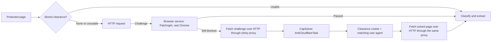

# Cloudflare status

Status recorded on 5 October 2026.

## How PageLode handles a challenge



Patchright is the primary path. A passed challenge records the clearance and the `patchright` route in the state file, so a later run, even a new process, replays it or goes straight to the browser. CapSolver is an optional last resort, enabled only when `CAPSOLVER_API_KEY` and either `PAGELODE_CAPSOLVER_PROXY_URL` or `PAGELODE_PROXY_URL` are set. Since 19 October 2026 its solved page is fetched with the HTTP client instead of a browser; that path has not been re-measured.

## Requirements

Patchright passes Cloudflare's standard challenge page when:

1. Chrome runs with a visible window: `BROWSER_SERVICE_HEADLESS=false` (the browser service default).
2. Locale and timezone are not emulated, because Cloudflare detects emulated values. Without a proxy, Chrome keeps the machine's values. With an HTTP or HTTPS proxy, the browser service launches Chrome with the timezone and languages of the proxy's exit IP.
3. The connection uses no proxy, or a sticky proxy session that keeps one IP for the whole run.

The proxy can come from any provider. Setup instructions are in [configuration](configuration.md#proxies).

## Test results

Target: `https://www.scrapingcourse.com/cloudflare-challenge`, a public Cloudflare test page. CapSolver disabled.

| Setup | Result |
|---|---|
| No proxy, visible Chrome | 8 of 8 passed in 1.5 to 3.4 seconds |
| No proxy, headless Chrome | 0 of 3 passed |
| Sticky mobile proxy, any country, visible Chrome | 2 of 2 passed in 7 to 10 seconds |
| Sticky mobile proxy, UK exit, visible Chrome | 2 of 2 passed in 10 to 21 seconds |
| Sticky mobile proxy, US exit, visible Chrome | 2 of 2 passed in about 9 seconds |
| Proxy with a new IP for every connection | 0 of 1 passed |

Before the locale and timezone override was removed, Patchright failed every run, with or without a proxy.

## CapSolver results

CapSolver returned a `cf_clearance` cookie on every task, but Cloudflare accepted it on only 1 of 9 replays (5 October 2026, solved page loaded in the former browser tier). Using the same sticky IP, the exact solved user agent, and a Chrome TLS fingerprint did not change that. The fallback is unreliable and should not be relied on when Patchright can pass.

CapSolver rejects proxies it cannot authenticate before solving. It requires a sticky proxy with a username and password.

## Known gaps

- The browser service container now runs headed Google Chrome on an Xvfb virtual display. Container results are in [browser service](browser-service.md), not in the table above.
- Proxy sessions are derived from the browser identity and stay stable across runs; PageLode rotates to a new session only after a host blocks the identity twice in a row. See [configuration](configuration.md#proxy-sessions).
- Crunchbase has not been retested since the locale fix.

## Live check, 19 October 2026

Mac, home IP, local headed browser service, no CapSolver.

| Target | Result |
|---|---|
| scrapingcourse Cloudflare challenge | `tls` attempt blocked by "Cloudflare challenge header"; `patchright` ok in about 19 seconds |
| scrapingcourse antibot challenge, new process | Went straight to `patchright` from the persisted route; ok in 0.9 seconds |
| react.dev | ok over `tls` |

## Test command

```sh
BROWSER_SERVICE_DEBUG=true make run-browser
```

```sh
PAGELODE_DEBUG=true pagelode --json https://www.scrapingcourse.com/cloudflare-challenge
```

`PAGELODE_DEBUG` output contains CapSolver provider, status, timing, cookie count, and browser major version without secret values. `BROWSER_SERVICE_DEBUG` logs browser service events such as navigation, challenge detection, and identity launches.
